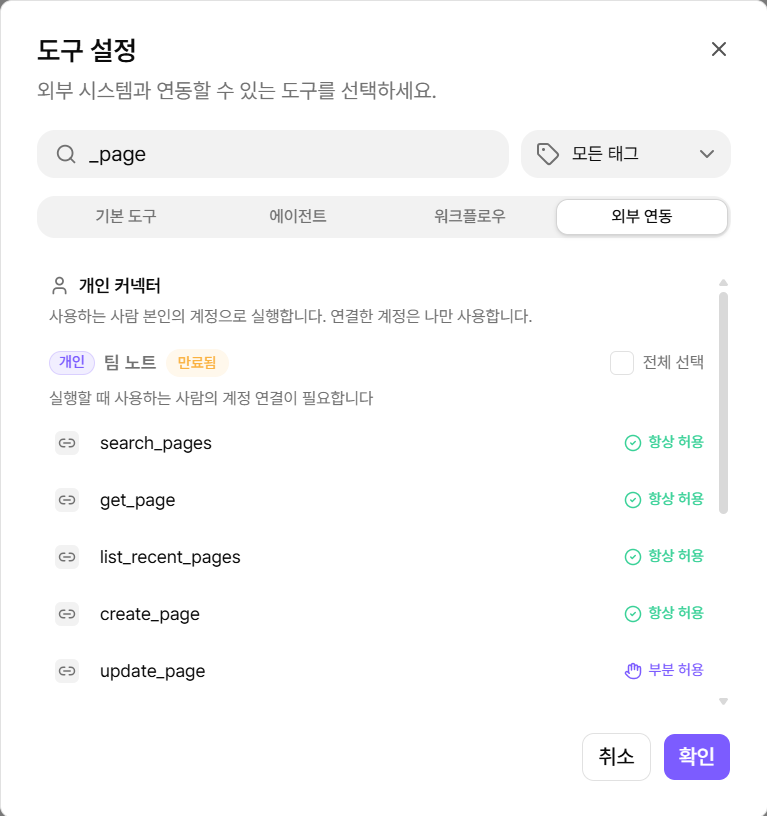
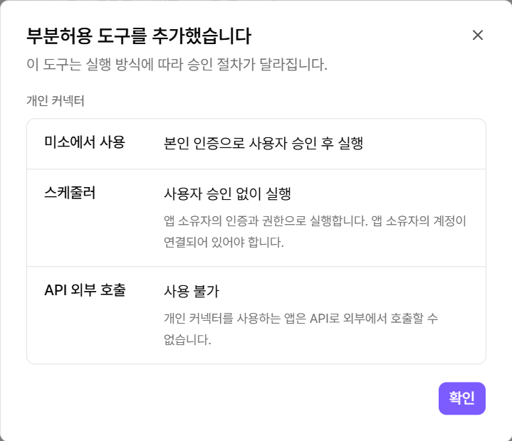
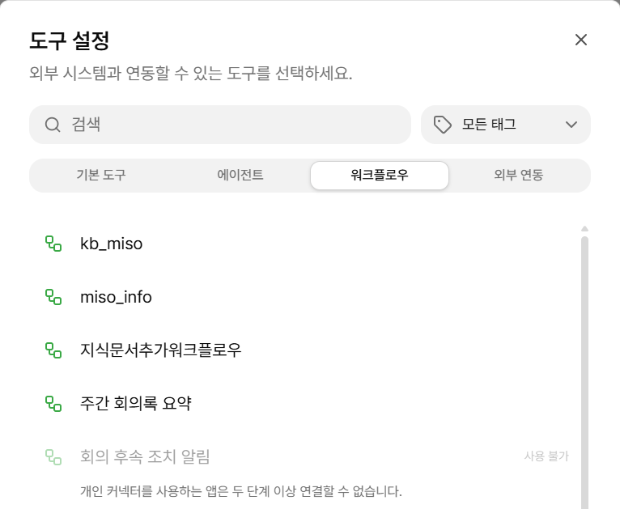
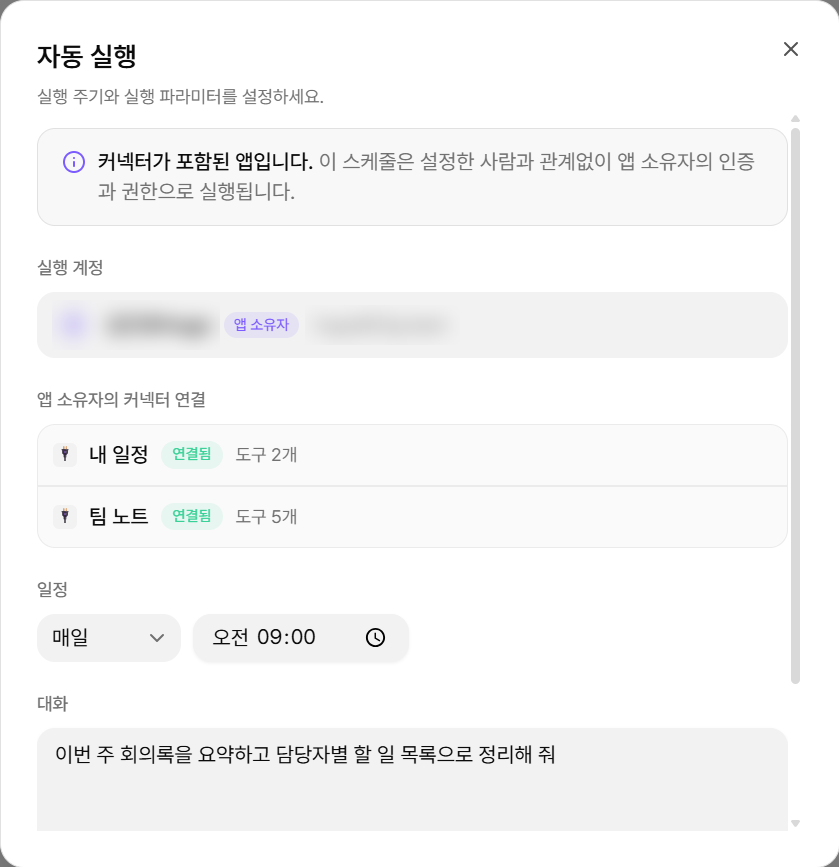
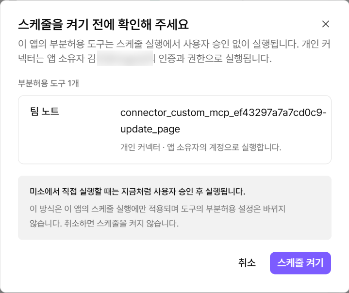
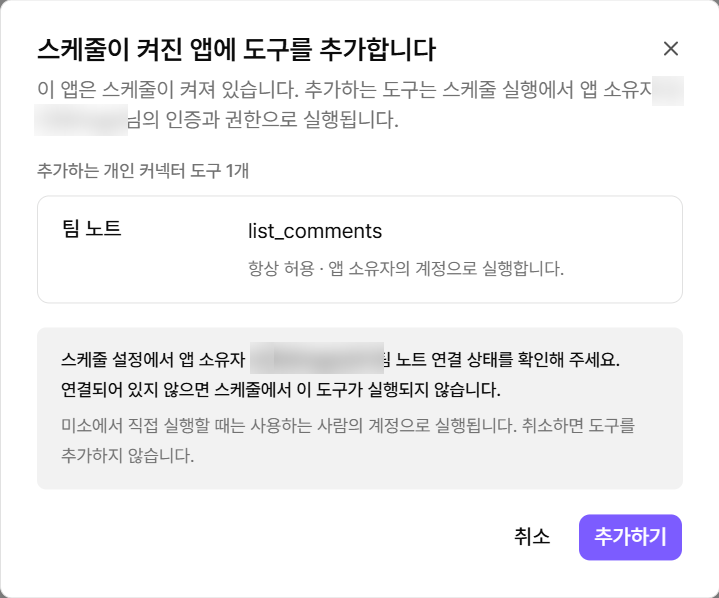

# 커넥터 사용하기

에이전트에 커넥터 도구를 추가하면 AI가 필요할 때 외부 서비스의 도구를 호출합니다.

커넥터 유형, 연결 방법, 실행 허용 수준, 사용 제한은 [connector](../tool/connector/ "mention")에서 확인합니다.


**커넥터는 워크플로우보다 에이전트에서 사용하는 것을 권장합니다.**

에이전트는 연결되지 않았거나 실행할 수 없는 도구의 사유를 받아 응답합니다. 워크플로우는 해당 도구 노드에서 실행이 실패합니다.


### 커넥터 도구 추가하기



#### 도구 선택 창 열기

에이전트 편집 화면의 도구 영역에서 **편집**을 선택합니다.



#### 외부 연동 도구 선택

**외부 연동** 탭에서 개인 커넥터 또는 조직 커넥터의 하위 도구를 선택합니다.

<figure><figcaption></figcaption></figure>

* 도구마다 실행 허용 수준이 표시됩니다.
* 연결하지 않은 개인 커넥터의 도구도 추가할 수 있습니다. "실행할 때 사용하는 사람의 계정 연결이 필요합니다"가 표시됩니다.
* 공통 인증에 문제가 있는 조직 커넥터는 선택할 수 없습니다. 제한 사유가 표시됩니다.



#### 저장 및 발행

도구 구성을 확인한 뒤 저장하고 발행합니다.




**API 키, 외부 공개, Slack 배포를 사용하는 에이전트에는 개인 커넥터를 추가할 수 없습니다.**

해제 방법은 **외부 연동 → 사용 중인 연동이 있는 앱**에서 확인합니다.


#### 부분 허용 도구를 추가할 때

부분 허용 도구를 추가하면 실행 방식을 안내하는 창이 열립니다.

<figure><figcaption></figcaption></figure>

| 실행 방식         | 개인 커넥터                              | 조직 커넥터                         |
| ------------- | ----------------------------------- | ------------------------------ |
| **앱에서 사용**    | 실행한 사람의 인증으로 실행합니다. 실행 전에 승인을 받습니다. | 조직 인증으로 실행합니다. 실행 전에 승인을 받습니다. |
| **자동 실행**     | 앱 소유자의 인증으로 승인 없이 실행합니다.            | 승인 없이 실행합니다.                   |
| **API 외부 호출** | 사용할 수 없습니다.                         | 승인 없이 실행합니다.                   |

### 앱을 사용할 때

개인 커넥터 도구는 에이전트를 실행한 사람의 계정으로 실행합니다. 앱 소유자의 계정은 사용하지 않습니다.

에이전트를 열면 필요한 개인 커넥터의 연결 상태를 확인합니다. 연결이 필요하면 연결 창이 열립니다.

<figure><figcaption></figcaption></figure>

연결되지 않은 커넥터의 도구는 실행하지 않습니다. 에이전트는 연결되지 않은 사유를 결과로 받습니다.

### 서브 에이전트로 사용할 때

개인 커넥터를 사용하는 에이전트를 도구로 등록하면 다른 에이전트의 서브 에이전트로 사용할 수 있습니다.

* 서브 에이전트의 개인 커넥터는 상위 에이전트를 실행한 사람의 계정으로 실행합니다.
* 상위 에이전트를 열 때 서브 에이전트의 개인 커넥터 연결 상태도 함께 확인합니다.


**개인 커넥터는 한 단계까지만 연결할 수 있습니다.**

개인 커넥터를 사용하는 하위 앱이 이미 있는 에이전트는 선택할 수 없습니다. `개인 커넥터를 사용하는 앱은 두 단계 이상 연결할 수 없습니다.`가 표시됩니다.


<figure><figcaption></figcaption></figure>

### 자동 실행할 때

자동 실행에서 개인 커넥터는 앱 소유자의 계정으로 실행합니다. 자동 실행을 켠 사람의 계정은 사용하지 않습니다.

#### 실행 계정과 연결 상태

**자동 실행 설정**에서 실행 계정과 앱 소유자의 커넥터별 연결 상태를 확인합니다.

<figure><figcaption></figcaption></figure>

* 앱 소유자가 연결하지 않은 커넥터에는 `앱 소유자가 연결해야 실행됩니다.`가 표시됩니다.
* 연결은 **도구 모음 → 외부 연동**에서 합니다.

#### 자동 실행 안내 창

다음 경우에 안내 창이 열립니다.

* 부분 허용 도구를 사용하는 에이전트에서 자동 실행을 켤 때. **스케줄 켜기**를 선택해야 합니다.
* 자동 실행이 켜진 에이전트에 개인 커넥터 도구를 추가할 때.

<figure><figcaption></figcaption></figure> <figure><figcaption></figcaption></figure>

자동 실행에서는 부분 허용 도구도 승인 없이 실행합니다.

실행 중 앱 소유자의 연결이 없거나 만료되면 해당 도구는 실행에 실패합니다. 실패 사유는 실행 기록에 남습니다.


**편집자도 자동 실행을 켤 수 있습니다.**

이 경우에도 개인 커넥터는 앱 소유자의 계정으로 실행합니다. 개인 커넥터를 사용하는 에이전트에 편집자를 추가하기 전에 확인합니다.

다른 사람이 본인 계정으로 자동 실행하려면 앱을 복제한 뒤, 본인 소유의 앱에서 설정합니다.

