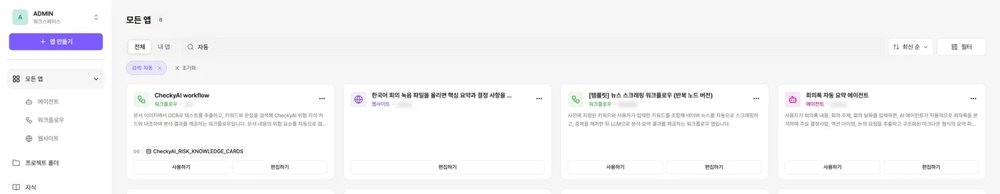
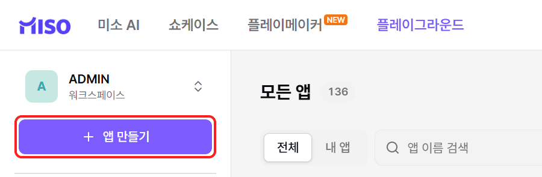

# 앱 리스트 관리하기

플레이그라운드 왼쪽 메뉴의 **모든 앱**에서는 내가 만든 앱과 공유받은 앱을 확인하고 관리합니다.

### 앱 찾기

**모든 앱** 아래의 **에이전트**, **워크플로우**, **웹사이트**를 눌러 유형별로 보거나 검색으로 앱을 찾습니다. 유형, 소유 권한, 태그로 앱 목록을 필터링할 수도 있습니다.

<figure><figcaption>
모든 앱 화면
</figcaption></figure>

### 앱 만들기

왼쪽 메뉴의 **+ 앱 만들기** 버튼을 클릭하면 앱 만들기 창이 열립니다. 다음 방식으로 새 앱을 만듭니다.

* **새로 만들기:** 앱 유형을 고르고 이름과 소개를 입력한 뒤 **만들기**를 클릭합니다. 자세한 내용은 [앱 만들기](./)를 확인합니다.
* **템플릿으로 시작:** 준비된 템플릿으로 앱을 만듭니다. 자세한 내용은 [템플릿으로 시작하기](template.md)를 확인합니다.
* **YAML 가져오기:** 내보낸 앱 파일을 가져와 앱을 등록합니다. 자세한 내용은 [기존 앱 가져오기](import-yml.md)를 확인합니다.

<figure><figcaption>
왼쪽 메뉴의 + 앱 만들기
</figcaption></figure>

### 프로젝트 폴더로 묶기

여러 앱을 프로젝트 단위로 묶어 멤버와 함께 보려면 왼쪽 메뉴의 **프로젝트 폴더**를 사용합니다. 자세한 내용은 [프로젝트 폴더](../project-folder/)를 확인합니다.
