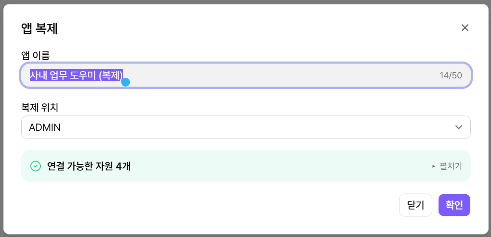
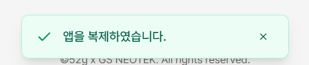
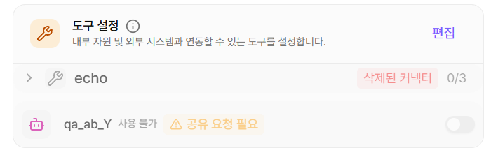

# 앱 복제하기


파일을 내보내거나 가져올 필요 없이 앱을 바로 복제할 수 있습니다. \
내가 속한 워크스페이라면 다른 워크스페이스도 **복제 위치**로 선택할 수도 있습니다.




#### 앱 리스트 열기

MISO 메인에서 **플레이그라운드 → 앱 리스트**를 선택합니다.



#### 앱 복제 메뉴 열기

복제할 앱 카드에서 **··· → 앱 복제**를 선택합니다.

<figure><figcaption></figcaption></figure>



#### 앱 이름 입력하기

**앱 이름**에는 `원래 앱 이름 (복제)`가 기본값으로 입력됩니다. 필요하면 새 이름을 입력합니다. 앱 이름은 최대 50자까지 입력할 수 있습니다.

<figure><figcaption></figcaption></figure>



#### 복제 위치 선택하기

**복제 위치**에서 앱을 만들 워크스페이스를 선택합니다. 기본값은 현재 워크스페이스입니다.

<figure><figcaption></figcaption></figure>



#### 연결 자원 확인하기

복제 위치를 선택하면 연결된 지식과 도구를 새 앱에서 사용할 수 있는지 확인합니다.

* **연결 가능한 자원**: 새 앱에서 그대로 사용할 수 있습니다. **펼치기**를 선택하면 목록을 확인할 수 있습니다.
* **연결 불가능한 자원**: 새 앱에서는 쓸 수 없는 지식·도구입니다. 복제는 그대로 진행할 수 있으며, 복제한 뒤 권한을 받으면 새 앱에서 활성화해 쓸 수 있습니다. **.txt**를 선택하면 목록을 파일로 내려받을 수 있습니다.

<figure><figcaption></figcaption></figure>


연결된 지식이나 도구가 없는 앱에는 이 영역이 표시되지 않습니다.




#### 앱 복제하기

**확인**을 선택합니다. 화면 하단에 **앱을 복제하였습니다.** 알림이 표시됩니다.

<figure><figcaption></figcaption></figure>



#### 복제한 앱 확인하기

복제 위치로 선택한 워크스페이스의 앱 리스트에서 새 앱을 확인합니다. 다른 워크스페이스에 복제했다면 상단의 워크스페이스 선택 메뉴에서 해당 워크스페이스로 변경합니다.

<figure><figcaption></figcaption></figure>


#### 연결 불가능한 자원이 있는 경우

복제한 앱의 편집 화면에서 해당 지식과 도구를 확인합니다. 복제한 워크스페이스에서 사용할 수 있는 자원으로 다시 연결합니다.




### (선택) 연결 불가능한 자원 활성화하기&#x20;

연결 불가능한 자원은 복제된 앱에서 빠지지 않고 **비활성화 상태로 남아 있습니다.** 권한을 받기 전까지는 답변이나 실행에 쓰이지 않고, 권한을 받으면 다시 연결하지 않아도 활성화해 쓸 수 있습니다.

<figure><figcaption>
에이전트 도구 비활성화 상태
</figcaption></figure>


환경변수는 같이 복제되지 않습니다. 복제한 앱에서 다시 입력해 주세요.



