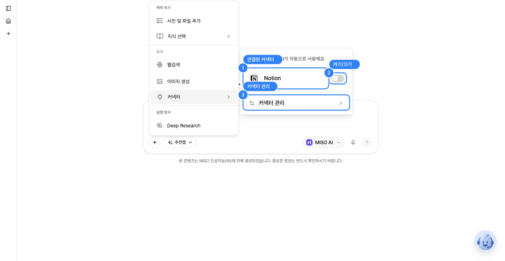
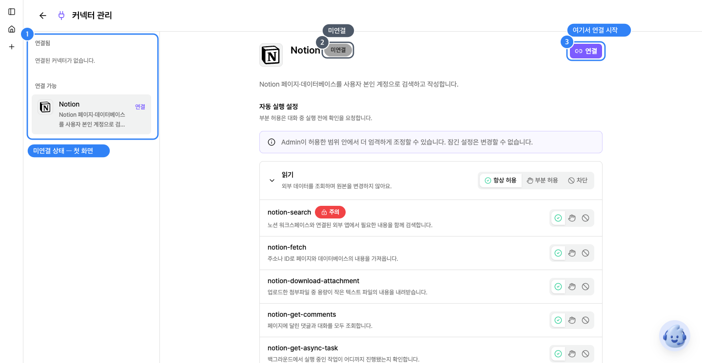
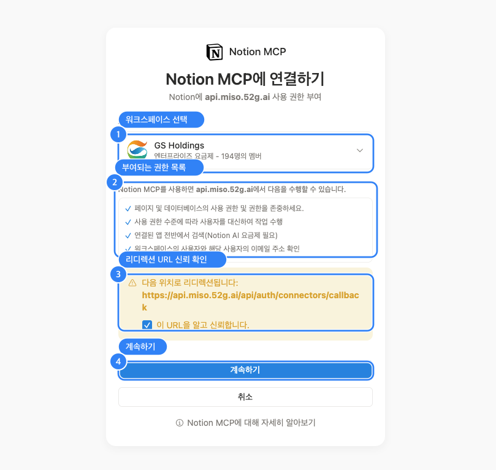
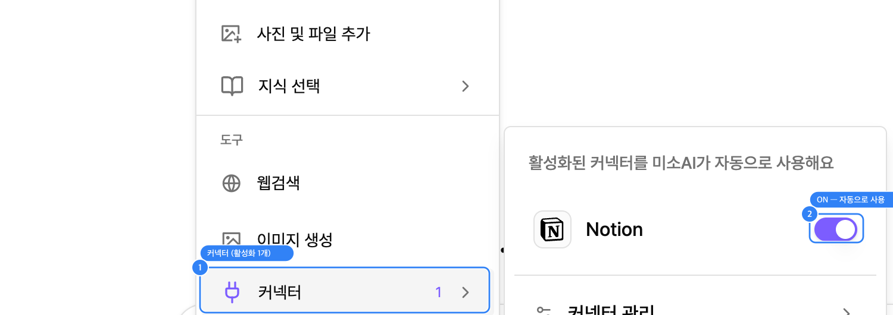
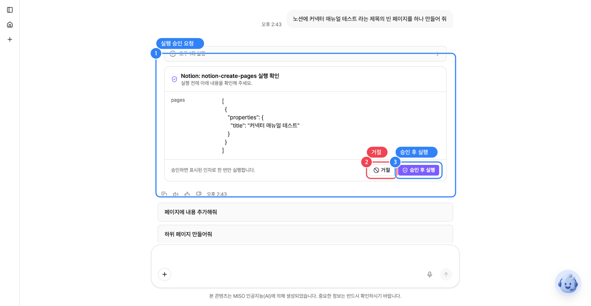
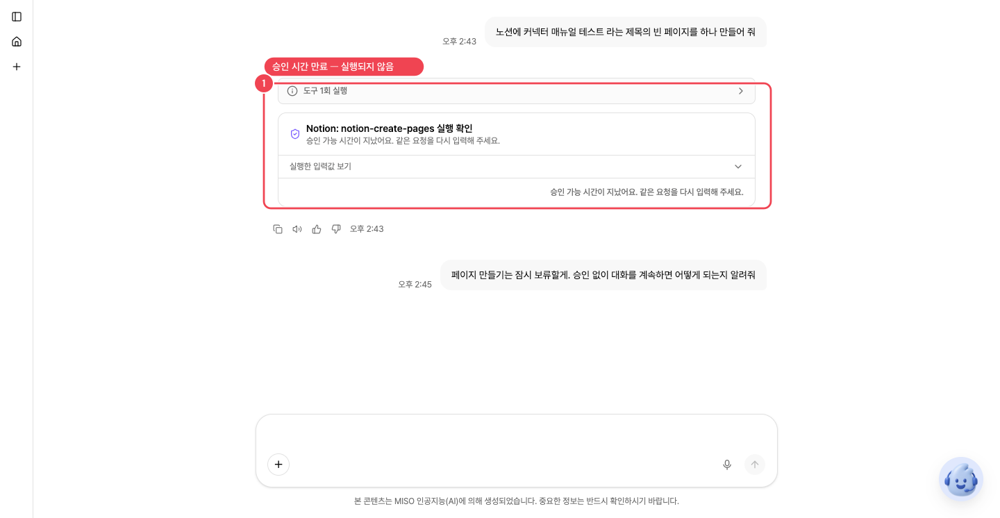

# 커넥터

### 커넥터란?

커넥터는 미소AI에서 조직에서 사용하는 서비스의 개인 계정을 연동하여, 대화 중 필요한 정보를 조회하거나 작업을 대신 수행하게 해주는 기능입니다. 노션처럼 평소 쓰는 서비스를 한 번 연결해두면, 이후에는 매번 서비스를 오가지 않고도 미소AI와의 대화 안에서 바로 조회하고 처리할 수 있습니다.

커넥터의 종류와 연결 방법, 실행 허용 수준은 [connector](../tool/connector/ "mention")에서 자세히 확인할 수 있습니다.

***

### 시작하기

#### 커넥터 메뉴 열기



대화 입력창 왼쪽 아래의 **＋** 버튼을 선택합니다.



맥락 추가, 도구, 실행 방식 세 구역으로 이루어진 메뉴가 열립니다. 도구 구역 안에 **커넥터** 항목이 있습니다.



도구 구역의 **커넥터**를 선택하면 오른쪽에 서브메뉴가 열립니다.



<figure><figcaption></figcaption></figure>


커넥터를 하나도 켜지 않았다면 "사용 가능한 커넥터가 없어요"라는 안내만 보입니다. 아래 **처음 연결하기**를 진행하세요.


***

### 처음 연결하기

커넥터 서브메뉴 아래의 **커넥터 관리**를 선택하면 연결 상태와 권한을 자세히 볼 수 있는 화면으로 이동합니다. 아직 연결한 적이 없다면 아래처럼 **미연결** 상태로 보입니다.


관리자가 활성화하지 않은 커넥터는 노출되지 않습니다. 연결 가능 커넥터가 없으면 조직 관리자에게 문의하세요.


<figure><figcaption></figcaption></figure>



### 연결 버튼 누르기

상세 패널 오른쪽 위의 **연결** 버튼을 누르면 해당 서비스의 로그인 화면으로 이동합니다. 예를 들어 노션은 아래와 같은 동의 화면을 보여줍니다.

<figure><figcaption></figcaption></figure>

로그인과 권한 동의 화면에서 확인할 항목은 [#undefined-1](../tool/connector/#undefined-1 "mention")를 참고하세요.


이 로그인과 동의 과정은 반드시 본인이 직접 진행해야 합니다. 미소AI나 다른 사람이 대신 로그인해 줄 수 없고, 그렇게 요청받아서도 안 됩니다.




### 연결 완료 확인하기

로그인과 권한 부여가 끝나면 자동으로 미소AI 화면으로 돌아오고, 상태가 연결됨으로 바뀝니다.

이제 ＋ 버튼의 커넥터 항목을 열어보면 활성화된 커넥터를 확인할 수 있어요. 활성화된 커넥터는 미소AI가 사용자의 질문에 맞춰 자동으로 사용합니다.

<figure><figcaption></figcaption></figure>



### 미소AI에서 사용하기

연결과 활성화가 끝나면 별도의 명령어 없이, 평소 대화하듯 요청만 하면 미소AI가 알아서 커넥터를 사용합니다. "커넥터를 써줘"처럼 도구 이름을 언급할 필요는 없습니다.

예를 들어 아래처럼 노션 관련 내용을 물어보면:

> 노션에서 52g 디자인 가이드 관련 페이지를 찾아줘

미소AI는 질문 안에서 노션 커넥터가 필요하다는 것을 스스로 판단해 자동으로 실행합니다. 읽기 권한이 항상 허용으로 설정되어 있어 별도 승인 없이 바로 실행되고, 조회된 내용이 표나 목록처럼 정리된 형태로 대화에 나타납니다.

<figure><figcaption></figcaption></figure>

이후 "이 중에서 최근에 수정된 페이지 내용도 보여줘"처럼 같은 대화 안에서 후속 질문을 이어가면, 미소AI가 그 맥락을 유지한 채 계속 활용됩니다.


부분 허용으로 설정된 동작을 요청하면, 결과가 바로 나오는 대신 앞서 본 승인 UI가 먼저 나타납니다.


<figure><figcaption>
부분 허용 - 승인 대기 화면
</figcaption></figure>

<figure><figcaption>
부분 허용 - 만료 화면
</figcaption></figure>



***
