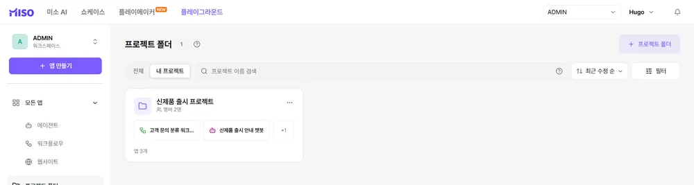

# 프로젝트 폴더

<figure><figcaption>
프로젝트 폴더 목록
</figcaption></figure>

프로젝트 폴더는 함께 쓰는 앱을 한곳에 모아 멤버와 공유하는 기능입니다. 플레이그라운드 왼쪽 메뉴의 **프로젝트 폴더**에서 사용합니다.

목록에서는 검색, 정렬, 필터로 폴더를 찾습니다. 폴더 카드에 마우스를 올려 별 표시를 선택하면 즐겨찾기에 추가됩니다.


**폴더에 담아도 앱은 그대로예요.**

담은 앱은 **모든 앱**에도 그대로 남고, 한 앱을 여러 폴더에 담을 수 있습니다. 멤버가 앱을 쓸 수 있는지는 앱 자체의 공유 범위로 정해집니다.


### 폴더 권한

폴더 소유자와 멤버가 할 수 있는 작업은 다음과 같습니다.

* **폴더 정보 수정·공유 범위 변경·멤버 초대·삭제**: 폴더 소유자만 할 수 있습니다.
* **앱 담기**: 소유자와 멤버 모두 할 수 있습니다.
* **앱 빼기**: 소유자는 모든 앱을, 멤버는 내 앱과 내가 담은 앱만 뺄 수 있습니다.
* **앱 공유 범위·편집자 변경**: 소유자와 멤버 모두 내 앱만 바꿀 수 있습니다.
