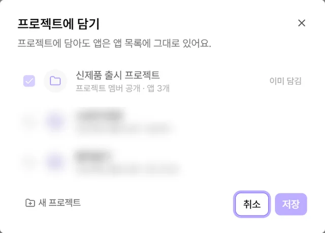
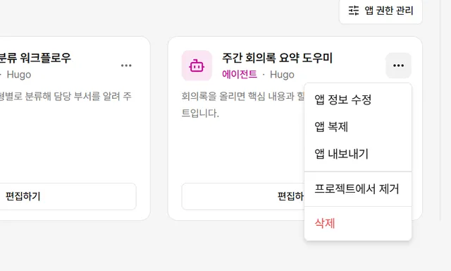
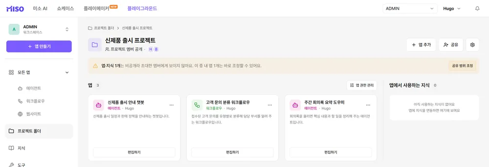

# 폴더에 앱 담기

앱은 폴더 화면이나 **모든 앱** 목록에서 담을 수 있습니다.

### 폴더에서 앱 추가하기

폴더 화면 오른쪽 위의 **앱 추가**를 선택합니다.

* **기존 앱에서 담기**: 앱 목록에서 만든 앱을 골라 이 폴더에 담습니다. 이미 담긴 앱은 선택할 수 없습니다.
* **새 앱 만들기**: 새로 만들거나 템플릿, YAML로 시작해 바로 이 폴더에 담습니다.

<figure><figcaption></figcaption></figure>

### 앱 목록에서 폴더에 담기

**모든 앱**에서 앱 카드의 **···** 메뉴를 열고 **프로젝트에 담기**를 선택합니다. 담을 폴더를 여러 개 고른 뒤 **저장**을 선택합니다. **새 프로젝트**로 폴더를 바로 만들 수도 있습니다.

<figure><figcaption></figcaption></figure>

### 폴더에서 빼기

폴더 안 앱 카드의 **···** 메뉴에서 **프로젝트에서 제거**를 선택합니다. 앱은 삭제되지 않고 **모든 앱**에 그대로 남습니다.

<figure><figcaption></figcaption></figure>


**삭제를 선택하면 앱 자체가 삭제됩니다.**

폴더에서만 빼려면 **프로젝트에서 제거**를 선택합니다.


### 폴더 화면 보기

폴더를 열면 왼쪽에 담긴 앱이, 오른쪽 **앱에서 사용하는 지식**에 그 앱들이 쓰는 지식이 표시됩니다. 지식은 따로 담지 않아도 자동으로 모이며, 지식마다 출처와 **N개 앱에서 사용**이 함께 표시됩니다.

<figure><figcaption>
폴더 화면
</figcaption></figure>
