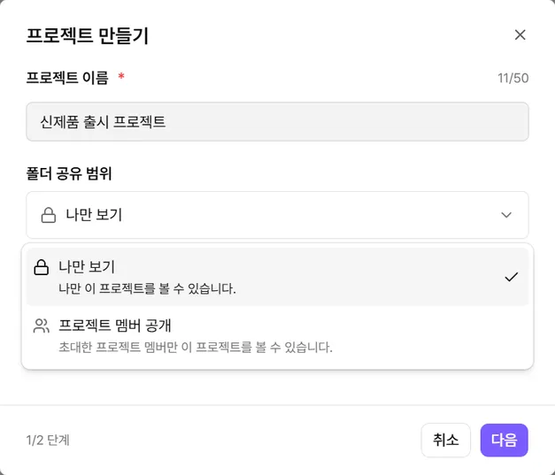
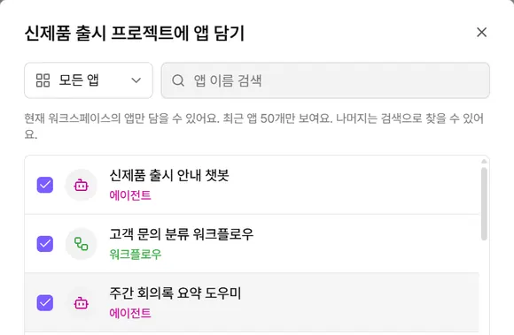
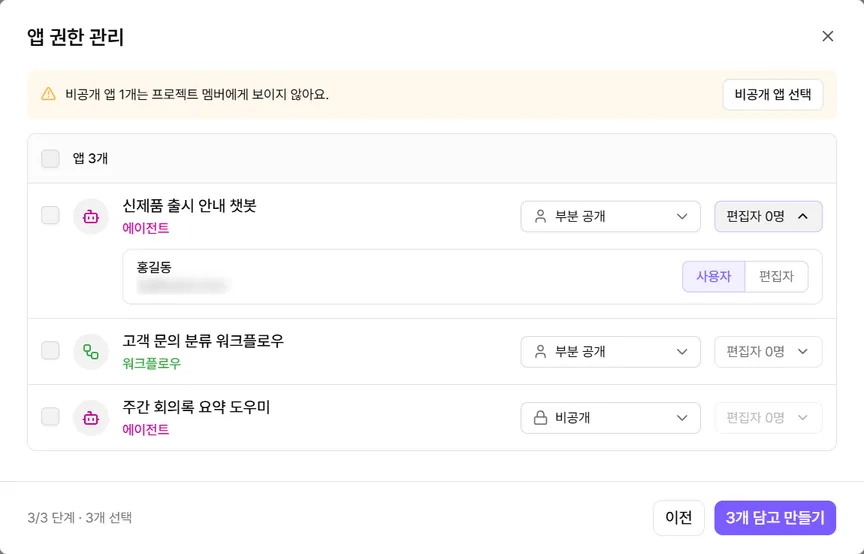
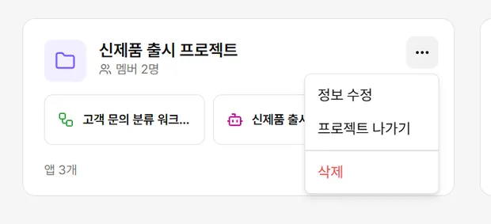

# 프로젝트 폴더 만들기

### 폴더 만들기



#### 만들기 창 열기

플레이그라운드 왼쪽 메뉴의 **프로젝트 폴더**를 선택한 뒤, 목록 오른쪽 위의 **+ 프로젝트 폴더**를 선택합니다.



#### 이름과 공유 범위 정하기

프로젝트 이름(최대 50자)을 입력하고 **폴더 공유 범위**를 고릅니다.

* **나만 보기**: 나만 이 프로젝트를 볼 수 있습니다.
* **프로젝트 멤버 공개**: 초대한 프로젝트 멤버만 이 프로젝트를 볼 수 있습니다.

<figure><figcaption></figcaption></figure>



#### 멤버 초대하기

**프로젝트 멤버 공개**를 골랐다면 이름이나 이메일로 멤버를 검색해 **초대**를 선택합니다.

<figure><figcaption></figcaption></figure>


현재 워크스페이스 멤버만 초대할 수 있습니다.




#### 앱 담기

폴더에 담을 앱을 고릅니다. 현재 워크스페이스의 앱만 담을 수 있고, 최근 앱 50개가 먼저 보입니다. 나머지는 검색으로 찾습니다.

<figure><figcaption></figcaption></figure>

이 단계는 건너뛰고 나중에 담아도 됩니다. 앱을 고르지 않으면 **건너뛰고 만들기**를 선택합니다.


만들 수 있는 폴더 수와 폴더에 담을 수 있는 앱 수에는 제한이 없습니다.




#### 앱 권한 관리하기

**프로젝트 멤버 공개** 폴더에 앱을 담았다면 앱별 공유 범위와 편집자를 정합니다. 비공개 앱은 프로젝트 멤버에게 보이지 않습니다.

<figure><figcaption></figcaption></figure>

자세한 내용은 [폴더 공유하기](share.md)를 확인합니다.



#### 만들기

**n개 담고 만들기**를 선택하면 폴더가 만들어지고 폴더 화면으로 이동합니다.



### 정보 수정과 삭제

폴더 카드의 **···** 메뉴나 폴더 화면의 **폴더 설정**에서 **정보 수정** 또는 **삭제**를 선택합니다. 정보 수정과 삭제는 폴더 소유자만 할 수 있습니다.

<figure><figcaption></figcaption></figure>


폴더를 삭제해도 담긴 앱은 삭제되지 않습니다. 앱은 **모든 앱**에 그대로 남습니다.

