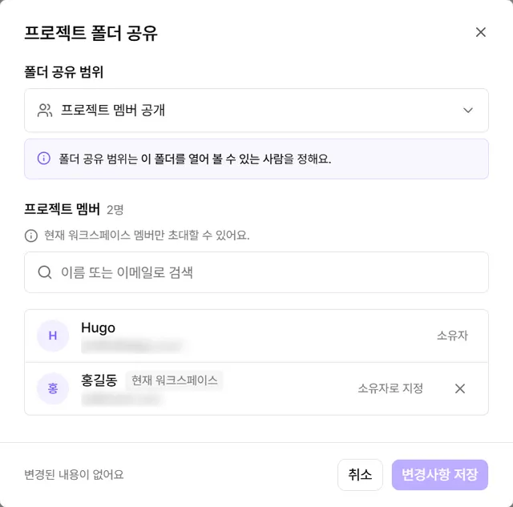
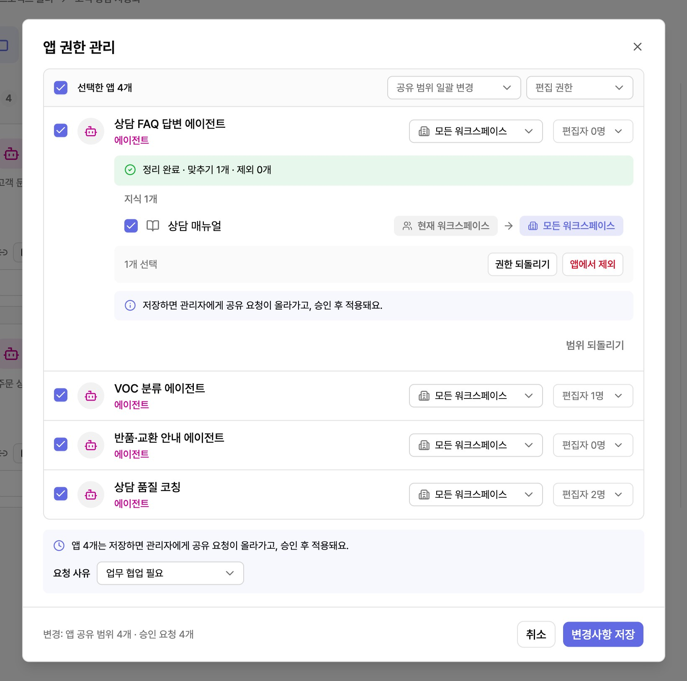

# 폴더 공유하기

### 폴더 공유 범위와 멤버

폴더 화면의 **공유**를 선택하면 **프로젝트 폴더 공유** 창이 열립니다. 공유 범위를 바꾸고 멤버를 초대하거나 초대를 취소한 뒤 **변경사항 저장**을 선택합니다.

<figure><figcaption></figcaption></figure>

* **나만 보기**: 나만 폴더를 볼 수 있습니다. 초대한 멤버는 저장할 때 제외됩니다.
* **프로젝트 멤버 공개**: 초대한 멤버도 폴더를 볼 수 있습니다.

멤버 옆의 **소유자로 지정**을 선택하면 폴더 소유자를 넘길 수 있습니다.


공유 범위 설정과 멤버 초대는 폴더 소유자만 할 수 있습니다. 멤버가 열면 읽기 전용으로 보입니다.


### 앱 권한 관리하기

폴더 화면 앱 목록 위의 **앱 권한 관리**를 선택하면 폴더에 담긴 **내 앱**의 공유 범위와 편집자를 한 화면에서 바꿀 수 있습니다.

앱마다 바꾸거나 **공유 범위 일괄 변경**, **편집 권한**으로 여러 앱을 한꺼번에 바꿉니다. **변경사항 저장**을 선택하면 함께 적용됩니다.

<figure><figcaption>
앱 권한 관리
</figcaption></figure>

**비공개**, **부분 공개**, **현재 워크스페이스**는 저장하면 바로 적용됩니다. **모든 워크스페이스**와 **외부 공개**는 관리자 승인 후 적용됩니다.

* **편집자**로 지정한 멤버는 그 앱을 편집할 수 있습니다. 앱 자체의 편집자 설정과 같은 값입니다.
* 다른 사람이 소유한 앱은 바꿀 수 없고 개수만 표시됩니다. 폴더 소유자도 마찬가지입니다.


**폴더에 담아도 멤버가 앱을 볼 수 없다면 앱 공유 범위를 확인합니다.**

앱 공유 범위에 멤버가 포함되어야 앱을 쓸 수 있습니다. 앱 소유자가 **앱 권한 관리**에서 공유 범위를 바꿉니다.


#### 관리자 승인이 필요한 공유 범위

**모든 워크스페이스**나 **외부 공개**를 고르면 **요청 사유**를 함께 선택합니다. 저장하면 관리자에게 공유 요청이 올라갑니다.

승인 전까지 앱에 **승인 대기중**이 표시되고 기존 공유 범위가 유지됩니다. 승인되면 새 공유 범위가 적용됩니다.

#### 연결된 지식 권한

앱 공유 범위를 바꾸면 그 앱이 쓰는 지식의 권한도 함께 맞춰집니다. 지식마다 다음을 고를 수 있습니다.

* **권한 되돌리기**: 지식의 권한을 원래대로 둡니다.
* **앱에서 제외**: 그 지식을 앱에서 뺍니다.

앱 공유 범위에 대한 자세한 내용은 [앱 공유하기](../share-publish-management/share/app.md)를 확인합니다.
