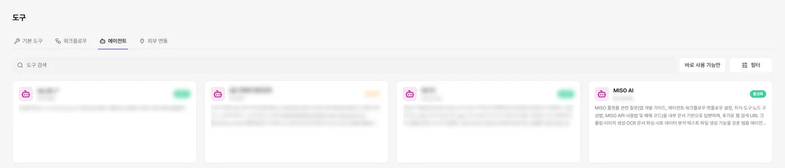

# 에이전트

만든 에이전트를 도구로 등록하면 Orchestrator Agent가 서브 에이전트로 호출할 수 있습니다.

전문 분야별 역할과 도구를 분리해 복잡한 요청을 처리할 때 사용합니다. 등록한 에이전트 도구는 플레이그라운드 왼쪽 메뉴의 **도구** → **에이전트** 탭에서 확인합니다.

<figure><figcaption></figcaption></figure>

* [에이전트 도구 등록](../agent/add-as-tool.md)에서 도구를 등록하고 발행합니다.
* [Orchestrator Agent](../agent/orchestrator-agent.md)에서 서브 에이전트 구성 방법을 확인합니다.
