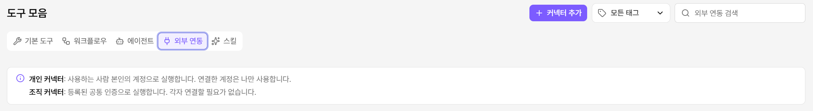
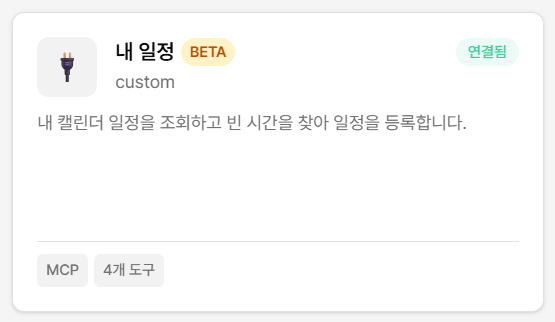
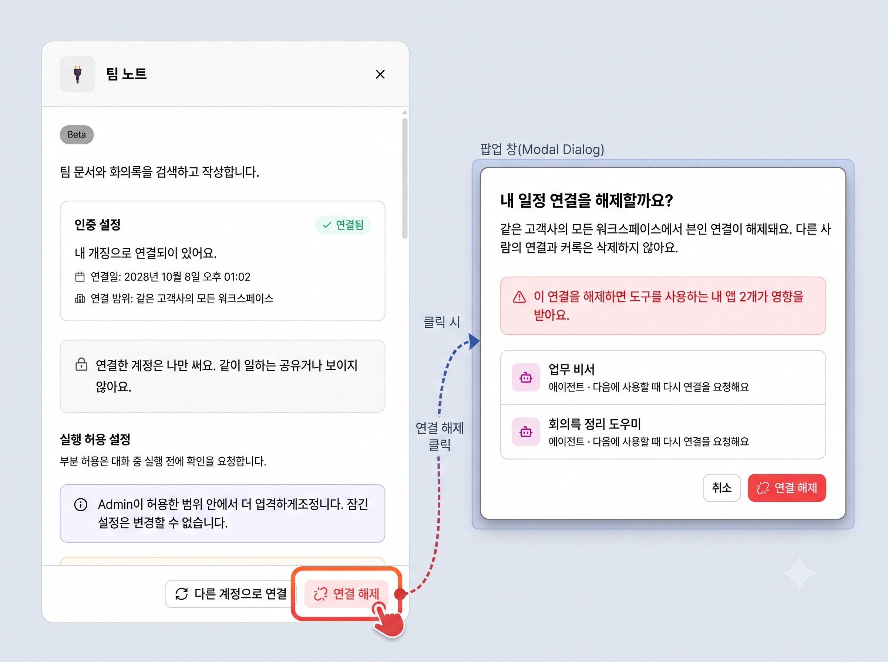
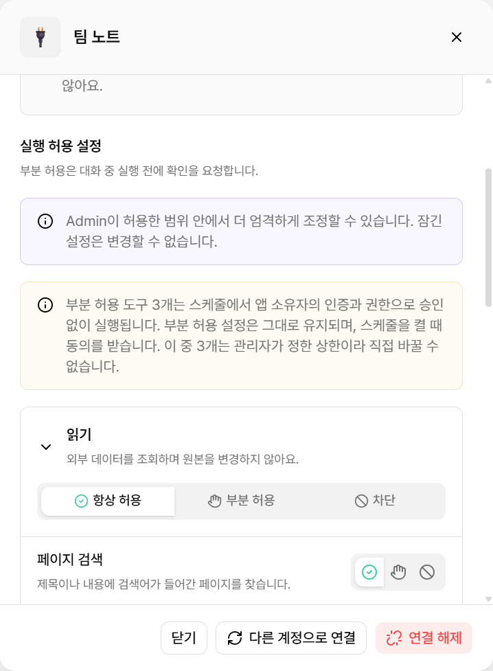
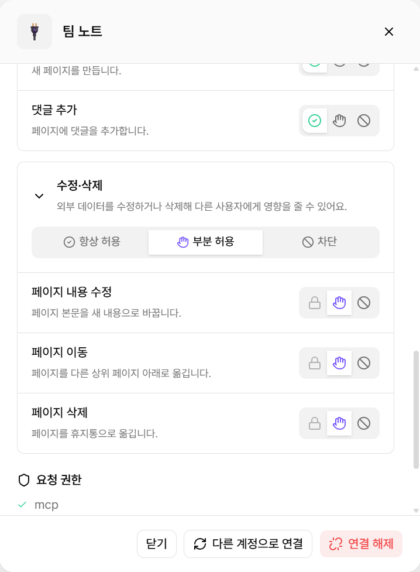
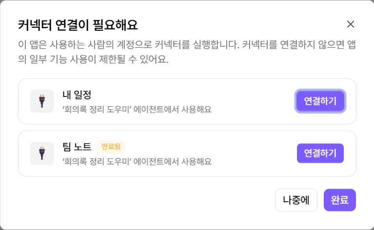

# 외부 연동

<figure><figcaption></figcaption></figure>

커넥터는 앱에서 외부 서비스의 정보를 조회하거나 작업을 실행하는 기능입니다.

관리자가 커넥터를 등록하고 워크스페이스에 할당합니다. 사용할 수 있는 커넥터는 **도구 모음 → 외부 연동**에서 확인합니다.

### 커넥터 유형과 상태

커넥터는 실행에 사용하는 인증 방식에 따라 개인 커넥터와 조직 커넥터로 나뉩니다.

| 유형         | 실행 계정          | 사용 방법               |
| ---------- | -------------- | ------------------- |
| **개인 커넥터** | 사용하는 사람의 계정    | 처음 사용할 때 계정을 연결합니다. |
| **조직 커넥터** | 관리자가 등록한 공용 계정 | 별도 연결 없이 사용합니다.     |


**개인 커넥터 연결은 본인에게만 적용됩니다.**

다른 구성원도 각자 계정을 연결해야 합니다. 연결한 계정은 다른 구성원에게 공유되지 않습니다.


커넥터 카드에서 현재 상태와 가능한 작업을 확인합니다.

| 상태             | 카드 표시     | 가능한 작업                  |
| -------------- | --------- | ----------------------- |
| **개인 · 미연결**   | -         | **연결하기**를 선택합니다.        |
| **개인 · 연결됨**   | 연결한 계정    | 상세 화면에서 연결을 해제할 수 있습니다. |
| **개인 · 만료**    | 만료됨       | **다시 연결**을 선택합니다.       |
| **조직 · 사용 가능** | 도구 수      | 바로 사용할 수 있습니다.          |
| **조직 · 인증 오류** | 관리자 확인 필요 | 관리자에게 문의합니다.            |

### 개인 커넥터 연결하기

개인 커넥터는 처음 사용할 때 한 번만 연결하면 됩니다.


커넥터 카드는 관리자가 등록해야 표시됩니다. 연결할 커넥터가 없다면 관리자에게 등록을 요청하세요.




#### 커넥터 선택

연결할 커넥터 카드에서 **연결하기**를 선택합니다.



#### 로그인 및 권한 승인

새 창에서 외부 서비스에 로그인합니다. 권한 승인 화면에서 다음 항목을 확인합니다.

* 외부 서비스에 워크스페이스가 여러 개면 연결할 워크스페이스를 선택합니다.
* MISO에 부여할 권한과 리디렉션 URL을 확인합니다.
* 인증 후 돌아갈 주소가 MISO 주소인지 확인합니다.

<figure><figcaption><p>권한 동의 화면 예시</p></figcaption></figure>


**로그인과 권한 승인은 본인이 직접 진행합니다.**

다른 사람에게 로그인을 요청하거나 대신 로그인하지 않습니다.




#### 연결 확인

인증이 완료되면 MISO로 돌아옵니다. 카드에 연결한 계정이 표시되면 연결이 완료된 것입니다.

<figure><figcaption></figcaption></figure>




**팝업이 차단된 경우**

차단 안내가 표시되면 **새 창에서 연결**을 선택합니다. 안내된 주소를 새 창에서 열어도 됩니다.


같은 회사에서는 워크스페이스를 옮겨도 다시 연결할 필요가 없습니다. 연결이 만료되면 카드에서 **다시 연결**을 선택해 인증을 갱신합니다.

#### 연결 해제하기

1. 커넥터 카드를 선택해 상세 화면을 엽니다.
2. 연결한 계정을 확인하고 **연결 해제**를 선택합니다.
3. 영향을 받는 앱과 자동 실행을 확인한 뒤 해제합니다.

<figure><figcaption></figcaption></figure>


연결을 해제하면 해당 커넥터를 사용하는 내 앱과 자동 실행에서는 도구를 실행할 수 없습니다.


### 실행 허용 수준

관리자는 커넥터의 하위 도구마다 실행 허용 수준을 설정합니다.

| 수준        | 앱에서 실행할 때          | 자동 실행할 때     |
| --------- | ------------------ | ------------ |
| **항상 허용** | 확인 없이 실행합니다.       | 확인 없이 실행합니다. |
| **부분 허용** | 실행 전 사용자 승인을 받습니다. | 승인 없이 실행합니다. |
| **차단**    | 실행하지 않습니다.         | 실행하지 않습니다.   |

<div><figure><figcaption><p>항상 허용</p></figcaption></figure> <figure><figcaption><p>부분 허용</p></figcaption></figure></div>

* 관리자가 설정한 수준은 상한입니다.
* 개인 커넥터는 상세 화면에서 더 엄격한 수준으로만 변경할 수 있습니다.
* 조직 커넥터는 관리자가 설정한 수준을 따릅니다.
* 차단한 도구는 앱에 추가해도 AI가 사용하지 않습니다.
* 부분 허용 요청은 일정 시간이 지나면 만료됩니다. 거절하거나 만료되면 도구를 실행하지 않습니다.

<figure><figcaption><p>부분 허용: 승인 대기</p></figcaption></figure>

<figure><figcaption><p>부분 허용: 승인 만료</p></figcaption></figure>

#### 도구 동작 분류

하위 도구는 동작에 따라 그룹으로 표시됩니다. 그룹 또는 도구별로 허용 수준을 설정할 수 있습니다.

| 분류           | 설명                             | 기본값       |
| ------------ | ------------------------------ | --------- |
| **읽기**       | 검색, 조회, 목록 확인처럼 원본을 변경하지 않습니다. | 대부분 항상 허용 |
| **쓰기·수정·삭제** | 생성, 수정, 이동, 삭제처럼 데이터를 변경합니다.   | 대부분 부분 허용 |

빨간 **주의** 배지가 있는 도구는 되돌리기 어렵습니다. 다른 구성원에게 영향을 줄 수도 있습니다. 항상 허용으로 변경하기 전에 작업 범위를 확인합니다.

### 앱에서 연결 확인하기

개인 커넥터를 사용하는 앱을 열면 연결 상태를 확인합니다. 이 확인은 앱 사용, 미리보기, 테스트하기에 적용됩니다.

연결이 필요한 커넥터가 있으면 **커넥터 연결이 필요해요** 창이 열립니다.

<figure><figcaption></figcaption></figure>

* 각 항목에는 커넥터 이름과 해당 커넥터를 사용하는 앱이 표시됩니다.
* 만료된 커넥터에는 **만료됨** 태그가 표시됩니다.
* **연결하기**를 선택하면 바로 연결합니다. 입력한 내용은 유지되며 질문도 자동으로 전송되지 않습니다.
* **나중에**를 선택하면 연결 없이 앱을 계속 사용할 수 있습니다. 연결하지 않은 커넥터의 도구는 실행되지 않습니다.


**“지금은 이 도구를 사용할 수 없어요. 앱 기능 사용에 제한이 있을 수 있어요.”가 표시되는 경우**

관리자 차단, 워크스페이스 미할당, 커넥터 삭제 등 연결 외의 이유로 도구를 사용할 수 없는 상태입니다. 관리자에게 문의합니다.


### 관리자에게 커넥터 요청하기

필요한 커넥터가 목록에 없으면 관리자에게 등록을 요청합니다. 아래 양식을 복사해 작성합니다.

```
[커넥터 등록 요청]

1. 연결할 서비스: (예: 사내 일정 시스템, Jira, Notion)
2. 서버 주소: (MCP 서버 URL 또는 OpenAPI 명세 위치. 모르면 담당 부서 또는 문서 링크)
3. 사용 목적: (어떤 앱에서 어떤 작업을 할지)
4. 사용할 워크스페이스:
5. 원하는 인증 방식: 개인 커넥터 / 조직 커넥터 / 잘 모름
   - 개인: 각자 본인 계정 권한으로 실행
   - 조직: 공용 계정 하나로 실행
6. 필요한 기능: 조회만 / 생성·수정 / 삭제 포함
7. 사용 경로: 테스트·앱 사용 / 자동 실행 / API·외부 공개·Webhook·웹사이트
8. 서비스 담당자: (인증 정보 또는 OAuth 앱 발급 문의처)
9. 희망 일정:
```


**요청 양식이나 메신저에 인증 정보를 적지 않습니다.**

비밀번호, API 키, 토큰, Client Secret은 포함하지 않습니다. 관리자가 서비스 담당자와 직접 확인해 등록합니다.



**인증 방식을 정하기 어렵다면 사용 경로를 기준으로 선택합니다.**

API 외부 호출, 외부 공개, Webhook 또는 웹사이트에서 사용해야 하면 조직 커넥터를 요청합니다.


이미 등록한 커넥터를 다른 워크스페이스에서 사용하려면 커넥터 이름과 워크스페이스만 관리자에게 전달합니다.
