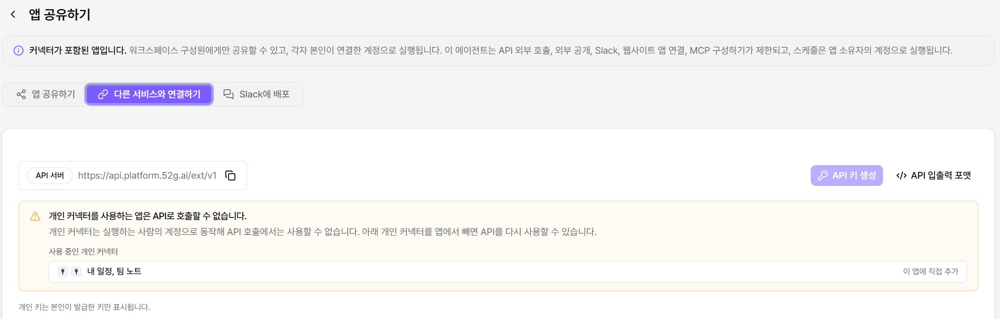
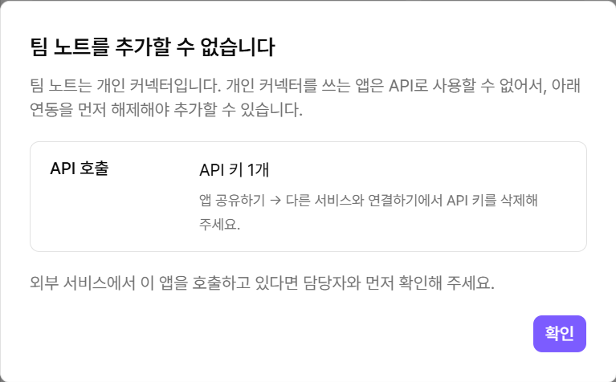

# 커넥터 사용 제한 및 권한

| 사용 위치                    | 사용 여부     | 실행 계정        |
| ------------------------ | --------- | ------------ |
| **테스트하기, 앱 사용, 미리보기**    | 가능        | 실행한 사람       |
| **자동 실행**                | 가능        | 앱 소유자        |
| **다른 앱의 도구·서브 에이전트로 호출** | 한 단계까지 가능 | 상위 앱을 실행한 사람 |
| **API 외부 호출**            | 불가        | -            |
| **외부 공개**                | 불가        | -            |
| **Webhook(워크플로우)**       | 불가        | -            |
| **웹사이트 연결**              | 불가        | -            |
| **PLAI Maker**           | 불가        | -            |

* 사용할 수 없는 경로는 화면에서 비활성화됩니다. 제한 사유와 사용 중인 개인 커넥터도 함께 표시됩니다.
* 개인 커넥터 자체도 웹사이트에 연결할 수 없습니다.
* 앱에서 개인 커넥터를 모두 제거하면 제한이 해제됩니다.
* 조직 커넥터는 기존 조직 도구 정책을 따릅니다.

<figure><figcaption>
개인 커넥터 사용 앱의 경우 API 사용 불가
</figcaption></figure>

#### 이미 연동한 앱에 추가하기

API 키, 외부 공개, Webhook, 웹사이트 연결을 사용하는 앱에는 개인 커넥터를 추가할 수 없습니다. 개인 커넥터를 추가하려고 하면 해제할 연동과 위치가 표시됩니다. 해당 연동을 해제한 뒤 다시 추가합니다.

<figure><figcaption></figcaption></figure>

| 사용 중인 연동    | 해제 위치                                     |
| ----------- | ----------------------------------------- |
| **API 키**   | **앱 공유하기 → 다른 서비스와 연결하기**에서 API 키를 삭제합니다. |
| **외부 공개**   | **앱 공유하기**의 공유 범위에서 외부 공개를 해제합니다.         |
| **Webhook** | 앱 설정에서 웹훅 트리거를 끕니다.                       |
| **웹사이트 연결** | 연결한 웹사이트의 **Extensions**에서 앱을 제거합니다.      |

### 권한

| 작업                                 | 권한이 있는 사람            |
| ---------------------------------- | -------------------- |
| **커넥터 등록, 워크스페이스 할당, 실행 허용 상한 설정** | 관리자                  |
| **커넥터 사용**                         | 커넥터가 할당된 워크스페이스의 구성원 |
| **개인 커넥터 연결·해제**                   | 본인                   |
| **앱에 커넥터 도구 추가**                   | 앱 소유자, 편집자           |
| **자동 실행 켜기·끄기**                    | 앱 소유자, 편집자           |
| **구성원 연결 확인·강제 해제**                | 관리자                  |

자동 실행은 앱 소유자 계정으로 실행합니다. 커넥터와 연결 상태는 내가 볼 수 있는 범위에서만 표시됩니다.


**편집자도 자동 실행을 켤 수 있습니다.**

개인 커넥터를 사용하는 앱은 앱 소유자 계정으로 실행됩니다. 편집자를 추가하기 전에 이 점을 확인합니다.

