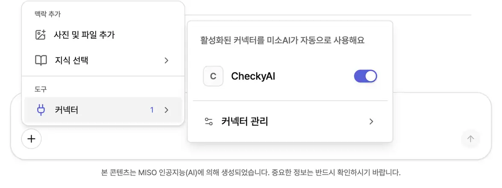
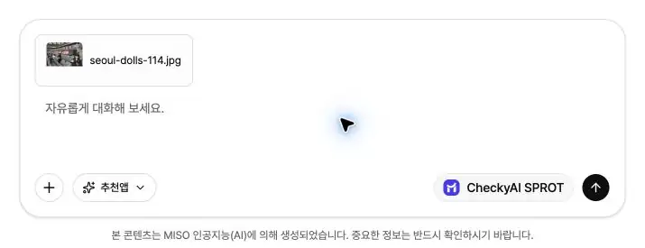
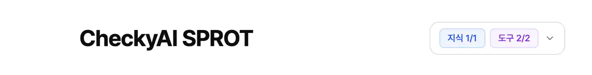
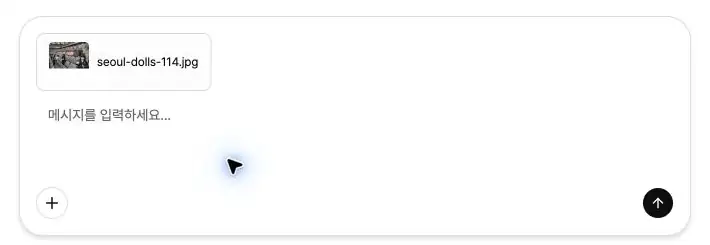
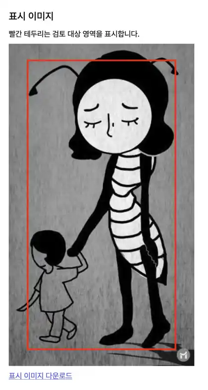

# CheckyAI

CheckyAI는 홍보 이미지의 문구와 시각 요소를 검수하는 조직 커넥터입니다. 확인이 필요한 영역은 이미지에 빨간 테두리로 표시합니다.

검수 결과에서 판정과 근거를 확인하고, 표시 이미지를 내려받아 수정 담당자에게 전달할 수 있습니다.


**관리자 설정이 먼저 필요합니다.**

관리자가 CheckyAI를 워크스페이스에 할당하고, 검수 기준과 지침을 앱에 설정해야 사용할 수 있습니다. 어떤 워크스페이스와 앱을 사용할지는 관리자에게 확인합니다.


### 사용 방법 선택하기

CheckyAI는 두 가지 방법으로 사용합니다. 관리자가 안내한 방법을 확인합니다.

| 방법               | 시작 위치                                | CheckyAI 사용 방법                              |
| ---------------- | ------------------------------------ | ------------------------------------------- |
| **미소AI에서 직접 켜기** | 미소AI 새 채팅                            | 입력창의 **＋ → 커넥터**에서 CheckyAI를 켭니다.           |
| **전용 앱에서 사용하기**  | 플레이그라운드의 앱 **사용하기** 또는 관리자가 전달한 앱 링크 | 관리자가 앱에 CheckyAI를 미리 연결해 두었습니다. 이미지만 첨부합니다. |

두 방법 모두 검수 지침이 저장된 앱에서는 이미지만 첨부해 전송하면 됩니다. 검수 방법이나 빨간 테두리 표시를 매번 요청하지 않아도 됩니다.

### 미소AI에서 직접 켜기



#### 워크스페이스와 앱 확인

오른쪽 위에서 관리자가 안내한 워크스페이스를 선택하고 **새 채팅**을 엽니다. 입력창에 표시된 앱 이름이 관리자가 검수 지침을 설정한 앱인지 확인합니다.



#### CheckyAI 켜기

입력창 왼쪽 아래의 **＋ → 커넥터**를 선택하고 **CheckyAI** 스위치를 켭니다.

<figure><figcaption></figcaption></figure>



#### 이미지 첨부 및 전송

**＋ → 사진 및 파일 추가**에서 검수할 이미지를 선택합니다. 입력창에 이미지 미리보기가 나타나면 전송합니다.

<figure><figcaption></figcaption></figure>

별도 문구 없이 전송해도 저장된 검수 지침에 따라 처리됩니다. 필요하면 "검수해 주세요"처럼 짧게 입력합니다.



### 전용 앱에서 사용하기



#### 앱 열기

**플레이그라운드**에서 관리자가 안내한 앱의 **사용하기**를 선택합니다. 관리자가 전달한 앱 링크로 열어도 됩니다.



#### 앱 이름과 연결된 지식·도구 확인

화면 위쪽에서 앱 이름을 확인합니다. 앱 이름 오른쪽의 **지식**, **도구** 표시로 연결된 지식과 도구를 사용할 수 있는지 확인합니다. 숫자는 앱에 연결된 개수에 따라 다릅니다.

<figure><figcaption></figcaption></figure>



#### 이미지 첨부 및 전송

**＋ → 사진 및 파일 추가**에서 검수할 이미지를 선택하고 전송합니다. 앱에 연결된 도구와 지침으로 검수가 진행됩니다.

<figure><figcaption></figcaption></figure>




**게시 목적을 함께 적으면 더 정확합니다.**

"고객 대상 SNS 광고이며, 다음 주 게시 예정입니다"처럼 게시 목적이나 대상을 함께 적으면 검수 맥락이 전달됩니다.


### 검수 결과 확인하기

응답이 끝나면 다음 항목을 순서대로 확인합니다.

| 항목          | 확인할 내용                   | 다음 행동                 |
| ----------- | ------------------------ | --------------------- |
| **판정과 위험도** | 수정이 필요한지, 위험 수준이 어느 정도인지 | 먼저 검토할 항목을 정합니다.      |
| **위험 요소**   | 어떤 요소가 왜 문제가 될 수 있는지     | 원본 이미지의 해당 부분과 비교합니다. |
| **문구 검수**   | 이미지에서 읽은 문구와 위험 표현       | 문구를 올바르게 읽었는지 확인합니다.  |
| **권장 조치**   | 표현, 구도, 손동작 등의 수정 제안     | 게시 의도에 맞는 수정안을 고릅니다.  |


**게시 여부는 담당자가 최종 판단합니다.**

표시 위치는 AI가 추정한 영역입니다. 원본 이미지와 비교해 위치와 맥락을 확인합니다.


### 표시 이미지 내려받기

답변 아래쪽의 표시 이미지에서 빨간 테두리가 가리키는 위치를 위험 요소 설명과 비교합니다.

<figure><figcaption></figcaption></figure>

1. 이미지 아래의 **표시 이미지 다운로드**를 선택합니다.
2. 새 탭에 이미지만 열리면 이미지를 마우스 오른쪽 버튼으로 선택한 뒤 **이미지를 다른 이름으로 저장**을 선택합니다.
3. 저장한 이미지를 검수 설명과 함께 수정 담당자에게 전달합니다.

이미지를 수정했다면 수정본을 다시 첨부해 재검수합니다.

### 문제가 생겼을 때

| 상황                               | 해결 방법                                                                                                   |
| -------------------------------- | ------------------------------------------------------------------------------------------------------- |
| **커넥터 목록에 CheckyAI가 없습니다.**      | 현재 워크스페이스가 맞는지 확인합니다. 맞다면 관리자에게 CheckyAI 할당을 요청합니다.                                                     |
| **CheckyAI를 켰는데 검수가 시작되지 않습니다.** | 미소AI 새 채팅에서는 **＋ → 커넥터**에서 CheckyAI가 켜져 있는지 확인합니다. 전용 앱에서는 앱 이름 오른쪽의 도구 표시를 확인하고, 문제가 계속되면 관리자에게 문의합니다. |
| **검수 기준이 답변에 반영되지 않습니다.**        | 앱 이름 오른쪽의 지식 표시를 확인하고 관리자에게 문의합니다.                                                                      |
| **이미지 미리보기가 나타나지 않습니다.**         | 파일 업로드가 끝났는지 확인하고 다시 첨부합니다.                                                                             |
| **이미지 속 문구를 다르게 읽었습니다.**         | 더 선명한 원본을 첨부하고, 실제 문구를 요청에 함께 적어 재검수합니다.                                                                |
| **검수 설명은 있지만 표시 이미지가 없습니다.**     | 위험 영역이 있다고 답변했는데 이미지가 없으면 아래 문구로 다시 요청합니다.                                                              |
| **다운로드가 안 되거나 오류가 반복됩니다.**       | 발생 시각, 사용한 워크스페이스, 오류 화면을 관리자에게 전달합니다.                                                                  |

표시 이미지가 빠졌을 때 사용할 요청 문구입니다.

```
방금 검수에서 확인된 위험 영역을
첨부 원본 이미지에 빨간 테두리로 표시해 주세요.
결과 이미지와 다운로드 버튼을 함께 제공해 주세요.
```
