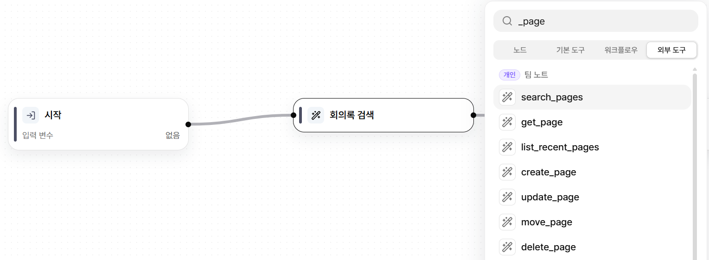
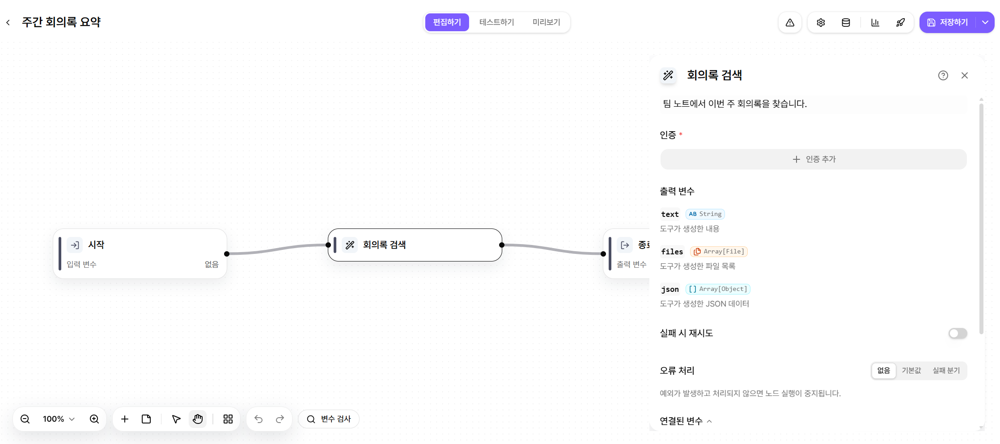
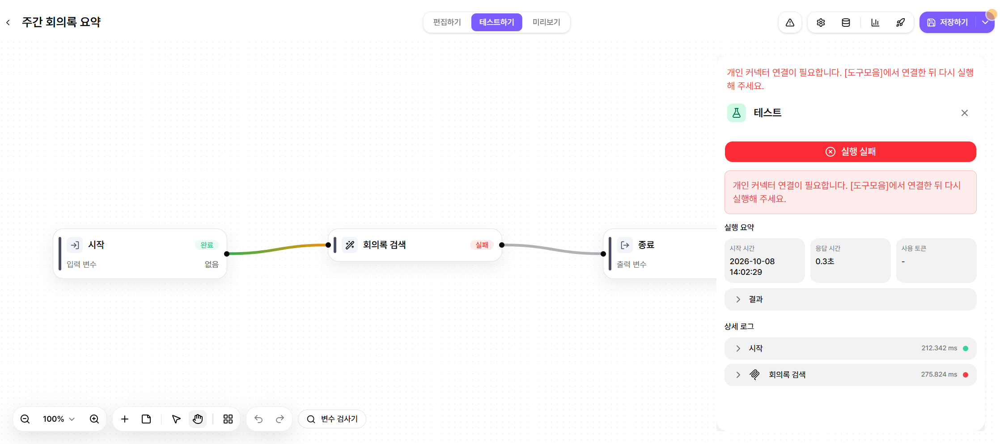

# 커넥터 사용하기

워크플로우에서는 지정한 단계에서 커넥터 도구를 실행합니다.

커넥터 유형, 연결 방법, 실행 허용 수준, 사용 제한은 [connector](../tool/connector/ "mention")에서 확인합니다.


**커넥터는 워크플로우보다 에이전트에서 사용하는 것을 권장합니다.**

워크플로우는 연결되지 않았거나 실행할 수 없는 커넥터를 만나면 해당 도구 노드에서 실행이 실패합니다.


### 커넥터 도구 노드 추가하기



#### 도구 노드 추가

워크플로우 편집 화면에서 노드를 추가합니다.

**외부 연동**에서 사용할 커넥터 도구를 선택합니다.

<figure><figcaption></figcaption></figure>



#### 입력값 설정

선택한 도구 노드에 전달할 입력값을 설정합니다.

<figure><figcaption></figcaption></figure>



#### 테스트 및 발행

**테스트하기**로 동작을 확인한 뒤 발행합니다.

연결이 필요한 개인 커넥터는 연결 창이 열립니다.



### 실행 시 제한 사항

| 상황                        | 워크플로우 동작                                                      |
| ------------------------- | ------------------------------------------------------------- |
| **연결이 없거나 만료된 경우**        | 해당 도구 노드에서 실행이 실패합니다.                                         |
| **연결 외의 이유로 실행할 수 없는 경우** | 해당 도구 노드에서 실행이 실패합니다. 실패 사유는 실행 기록에서 확인할 수 있습니다.              |
| **Webhook 트리거**           | 개인 커넥터를 사용하는 워크플로우는 Webhook으로 실행할 수 없습니다.                     |
| **도구로 등록**                | 다른 앱에서 호출할 수 있습니다. 개인 커넥터는 상위 앱을 실행한 사용자의 계정으로 한 단계까지만 실행합니다. |
| **자동 실행**                 | 앱 소유자의 계정으로 실행합니다. 소유자의 연결이 없으면 해당 노드에서 실행이 실패합니다.            |

<figure><figcaption></figcaption></figure>


**개인 커넥터를 사용하는 워크플로우 도구는 두 단계 이상 연결할 수 없습니다.**

이 도구를 사용하는 앱은 다른 앱의 도구로 다시 추가할 수 없습니다.

