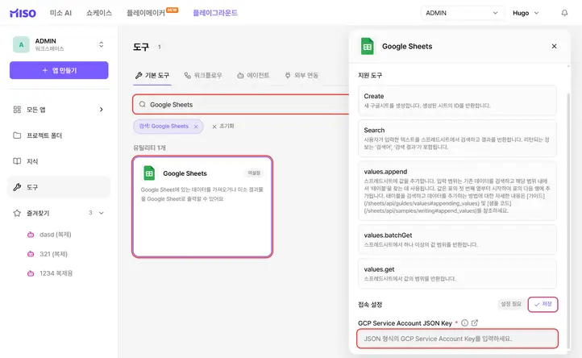

# \[참고] Google Sheet 도구 키 발급 및 설정하기

### STEP 1. Google Sheets API 활성화

1. **GCP 사이트에 접속:**

* Google Cloud Console([https://console.cloud.google.com](https://console.cloud.google.com/))에 접속 후 로그인합니다.
  * **52g.team 과 같은 회사 계정은 계정 생성이 차단될 수 있습니다.**
* 기존 프로젝트를 선택하거나 새 프로젝트를 생성합니다.

<figure><figcaption></figcaption></figure>

<figure><figcaption></figcaption></figure>

2. **API 활성화:**

* 좌측 메뉴에서 **API 및 서비스 > 라이브러리**로 이동합니다.

<figure><figcaption></figcaption></figure>

* 검색창에 "Google Sheets API"를 입력하고 **사용 설정**을 클릭합니다.

<figure><figcaption></figcaption></figure>

### STEP 2. 서비스 계정 생성

1.  **서비스 계정 메뉴로 이동:**

    * 좌측 메뉴에서 **IAM 및 관리자 > 서비스 계정**으로 이동합니다.

    <figure><figcaption></figcaption></figure>
2.  **서비스 계정 생성:**

    * **서비스 계정 만들기**를 클릭하고 서비스 계정 이름을 입력하여 생성합니다.

    <figure><figcaption></figcaption></figure>

### STEP 3. JSON 키 발급

1.  **키 생성:**

    * 생성된 서비스 계정을 클릭한 후 **키** **관리**으로 이동합니다.
    * 아래 사진의 이메일 부분은 추후 이 도구를 사용하는 사용자에게 필요한 정보입니다. 복사 후 공지하기 바랍니다.

    <figure><figcaption></figcaption></figure>

    * **키 추가 > 새 키 만들기**를 선택하고 **JSON** 형식을 선택합니다.

    <figure><figcaption></figcaption></figure>
2. **JSON 파일:**
   * JSON 파일이 자동으로 다운로드되며, 이 파일이 API 인증에 필요한 **서비스 계정 키**입니다.
   * 해당 JSON 파일을 열어서 복사합니다. (안열리는 경우 텍스트 파일(메모장)으로 열기)

### STEP 4. MISO 도구 등록

1.  MISO 플레이그라운드 왼쪽 메뉴의 **도구**에서 **Google Sheets**를 검색한 뒤, **GCP Service Account JSON Key** 칸에 복사한 JSON 키를 붙여넣고 **저장**을 클릭합니다.

    <figure><figcaption></figcaption></figure>
2. 활성화 상태를 확인합니다.


### '사용자 권한이 부족합니다. 관리자에게 문의해주세요.' 오류가 발생해요.

MISO에서 도구 등록은 해당 워크스페이스의 관리자 권한을 가진 사용자만 가능합니다.

도구 등록이 필요한 경우, 워크스페이스 관리자에게 문의하여 등록을 요청해 주세요.

