# 복리후생 안내 에이전트

## 개요

***

간단한 복리 후생규정 안내 서비스 구현 튜토리얼을 진행하면서 미소에서 어떻게 데이터를 업로드하고 또 그 데이터를 기반으로 어떻게 GenAI가 답변하도록 하는지 알아봅니다.

이 튜토리얼에서는 아래의 내용들에 대해서 다룹니다.

* 미소에 문서를 업로드
* 미소에 업로드된 문서에서 검색 테스트
* 미소에 업로드된 문서를 활용하는 에이전트를 구현
* 미소에서 구현한 에이전트를 저장 및 배포

## 지식 추가하기

***

먼저 가상의 복리후생규정을 미소에 업로드하겠습니다.

<figure>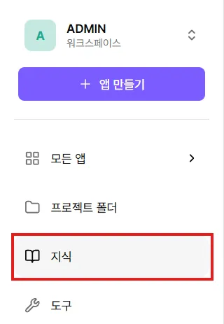<figcaption></figcaption></figure>

플레이그라운드 왼쪽 메뉴에서 "지식"을 클릭하여 지식 화면으로 이동합니다.

<figure>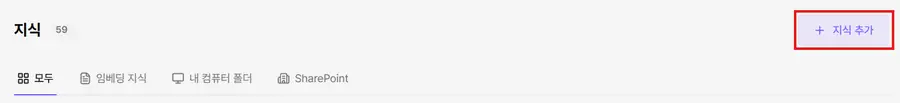<figcaption></figcaption></figure>

<figure>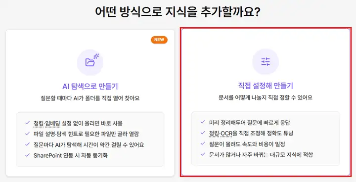<figcaption></figcaption></figure>

지식 화면 오른쪽 위의 "+ 지식 추가" 버튼을 클릭한 뒤, 지식을 추가할 방식으로 "직접 설정해 만들기"를 선택합니다. 문서를 어떻게 나눠 저장할지 직접 정할 수 있는 방식입니다.

<figure>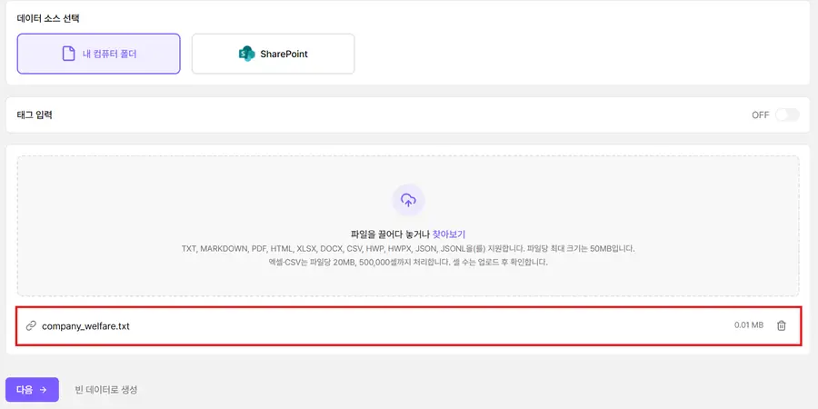<figcaption></figcaption></figure>



데이터 소스 선택 영역에서 "내 컴퓨터 폴더"를 선택한 뒤 company\_welfare.txt 파일을 드래그 앤 드롭하거나 "찾아보기"를 클릭하여 업로드합니다. 문서가 업로드되면 위와 같이 파일 이름이 업로드 영역 아래에 표시됩니다. 지식 이름을 입력하지 않으면 첫 번째 파일 이름이 지식 이름으로 사용됩니다. "다음" 버튼을 클릭하여 데이터 임베딩 단계로 이동합니다.

<figure><figcaption></figcaption></figure>

company\_welfare.txt는 가상의 복리후생규정을 담고 있는 텍스트 문서입니다. 마크다운 스타일로 작성되어 있고 각각의 복리후생규정은 "===" 텍스트로 구분되어 있습니다. 사실 대부분의 회사에서 복리후생규정은 PDF 형식으로 작성되어 있는 것이 일반적이나 이 예제에서는 위와 같은 형식으로 미리 전처리된 문서가 준비되어 있다고 가정하겠습니다.

<figure>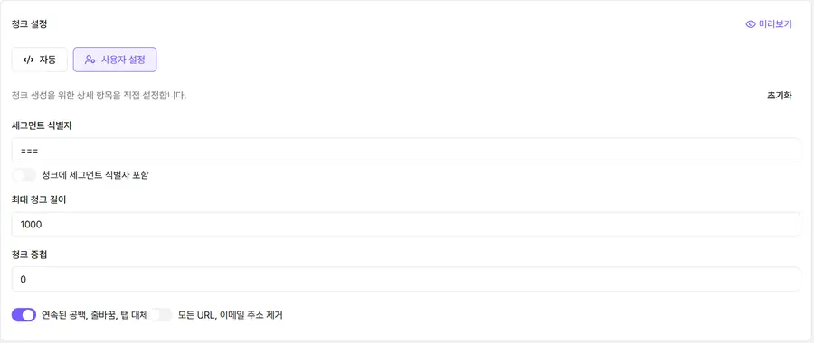<figcaption></figcaption></figure>

이제 준비된 문서를 미소의 DB에 저장해 보겠습니다. 청크 설정 영역에서 "사용자 설정" 버튼을 클릭하여 문서를 어떻게 나눠 저장할지 직접 설정해 보겠습니다. 아래와 같이 설정합니다.

* 세그먼트 식별자: ===
* 청크에 세그먼트 식별자 포함: 끔
* 최대 청크 길이: 1000
* 청크 중첩: 0
* 연속된 공백, 줄바꿈, 탭 대체: 켬
* 모든 URL, 이메일 주소 제거: 끔

이렇게 설정한 뒤 오른쪽 위의 "미리보기" 버튼을 클릭하면 company\_welfare.txt 문서가 DB에 어떻게 chunk(특정 단위로 잘려서)되어 저장될 예정인지 아래와 같이 확인해 볼 수 있습니다.

<figure>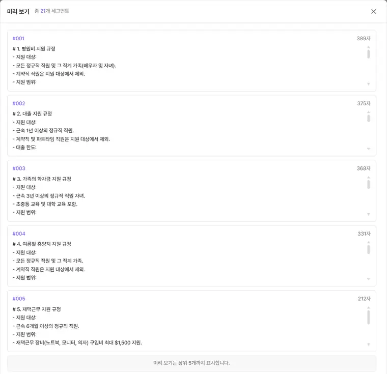<figcaption></figcaption></figure>

<figure>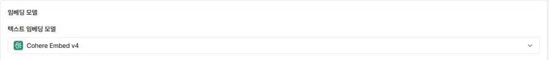<figcaption></figcaption></figure>

임베딩 모델 영역에서 사용 가능한 모델 중 가장 적절한 모델을 설정합니다. 이 문서는 한글로 작성되어 있으므로 이 예제에서는 여러 언어를 지원하는 Cohere Embed v4 모델을 사용하겠습니다.

<figure>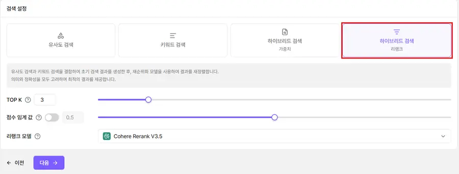<figcaption></figcaption></figure>

마지막으로 검색 설정 영역에서 DB에 저장된 데이터가 어떻게 검색될지 설정하겠습니다. 이 예제에서는 "하이브리드 검색 리랭크" 방법을 선택하겠습니다. 이 방법은 유사도 검색과 키워드 검색을 함께 사용해 검색어와 관련된 청크들을 찾은 뒤, 리랭크 모델을 이용해서 한 번 더 검색어에 가장 적절한 순으로 청크들을 재정렬하는 방식으로 단순 유사도 검색 대비 성능이 더 좋은 것으로 알려져 있습니다.

여기까지 설정한 뒤 "다음" 버튼을 클릭하면 DB에 데이터를 저장하는 작업이 진행됩니다.

<figure>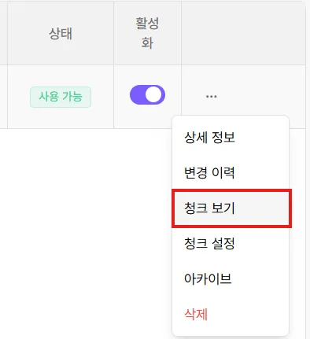<figcaption></figcaption></figure>

상태가 "사용 가능"으로 변경되면 이제 DB에 저장된 데이터를 활용할 수 있습니다. 오른쪽의 ··· 버튼을 클릭한 뒤 "청크 보기" 메뉴를 클릭하여 DB에 잘 저장되었는지 확인해 봅시다.

<figure>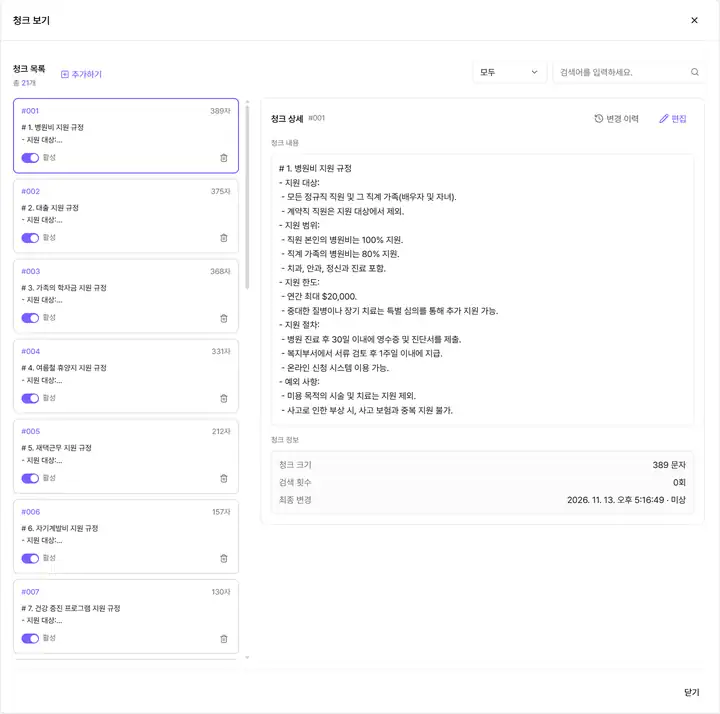<figcaption></figcaption></figure>

앞서 우리가 의도한 대로 복리후생규정의 각 항목이 하나의 청크로 나뉘어서 잘 저장되어 있음을 확인할 수 있습니다. 각각의 청크를 클릭하면 상세 내용을 확인할 수 있습니다. 활성 토글을 끄면 해당 청크는 검색이 되지 않도록 설정할 수도 있습니다. 또한 청크의 수정·삭제도 이 화면에서 가능합니다. 따라서 일부 청크에 문제가 있는 경우에 전체 문서를 삭제하고 다시 업로드하는 것이 아닌 해당 부분만 수정할 수 있습니다.

## 지식 검색 테스트

***

<figure>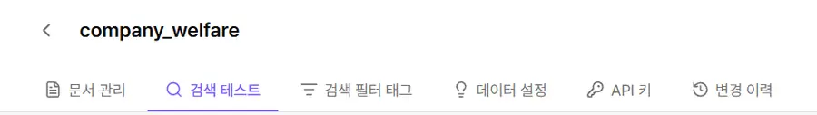<figcaption></figcaption></figure>

업로드된 지식이 제대로 검색되는지 테스트해 보겠습니다. "지식 → company\_welfare → 검색 테스트" 탭으로 이동합니다.

미소에서는 데이터를 Vector DB라는 DB로 관리합니다. Vector DB는 유사도 기반으로 검색할 수 있어 GenAI와 붙여서 사용하기에 좋다는 평가를 받고 있습니다. 아래의 2개의 예시를 통해 Vector DB의 장점에 대해서 설명 드려보도록 하겠습니다.

<figure>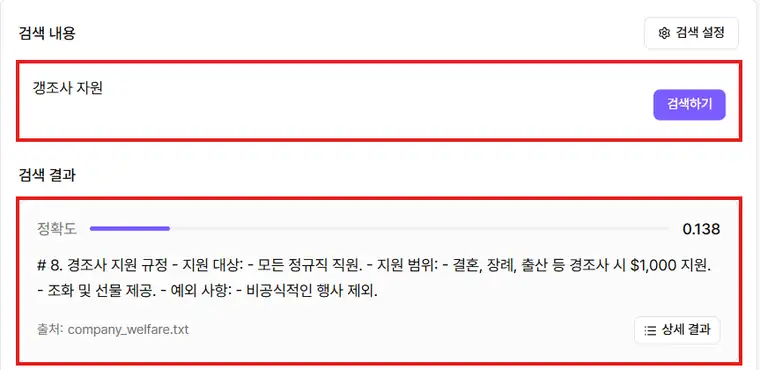<figcaption></figcaption></figure>

위의 검색 내용은 Vector DB의 유사도 기반 검색이 가지는 장점을 보여줍니다. 사용자가 경조사 지원을 의도했지만 실제로 입력된 검색어가 "갱조사 자원"이라고 가정해 봅시다. 일반적인 DB이면 당연히 검색이 불가하지만 Vector DB는 사용자가 의도한 경조사 지원 규정 청크를 가장 먼저 가져옴을 확인할 수 있습니다.

<figure>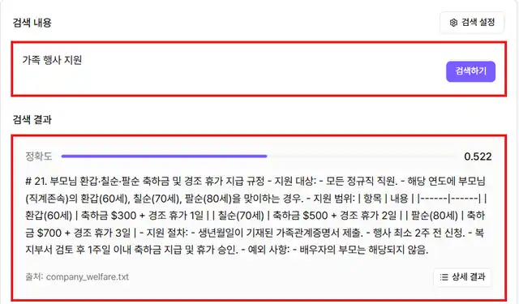<figcaption></figcaption></figure>

<figure>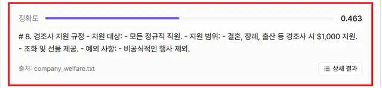<figcaption></figcaption></figure>

비슷한 예시로 이번에는 맥락은 닮았지만 워딩은 다른 "가족 행사 지원"이라는 키워드로 검색한 경우를 가정해 봅시다. 검색어에 "경조사"라는 단어가 없어도 부모님 환갑·칠순 축하금 규정과 경조사 지원 규정처럼 가족 행사와 관련된 청크가 위쪽에 검색됨을 확인할 수 있습니다.

## 복리후생 안내 에이전트 구현

***

이제 데이터가 업로드되었으니 이 데이터를 기반으로 사용자들의 질문에 대해서 사내 복리후생규정에 근거해 답변해 주는 에이전트를 구현해 보겠습니다.

<figure><figcaption></figcaption></figure>

먼저 상단 메뉴바에서 "플레이그라운드" 메뉴를 클릭하여 플레이그라운드 화면으로 이동합니다.

<figure>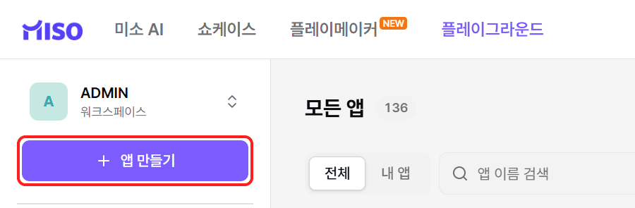<figcaption></figcaption></figure>

왼쪽 메뉴의 "+ 앱 만들기" 버튼을 클릭하여 앱 만들기 창을 엽니다.

<figure>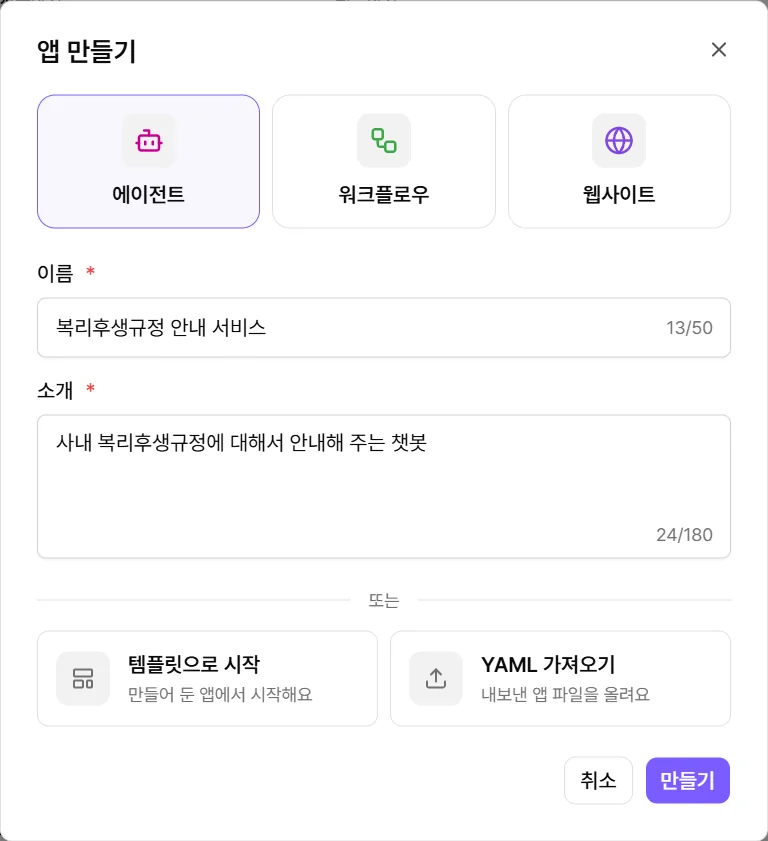<figcaption></figcaption></figure>

앱 유형은 "에이전트"로 선택하고 이름과 소개를 위의 내용을 참조하여 적절히 작성한 뒤 "만들기" 버튼을 클릭합니다.

<figure>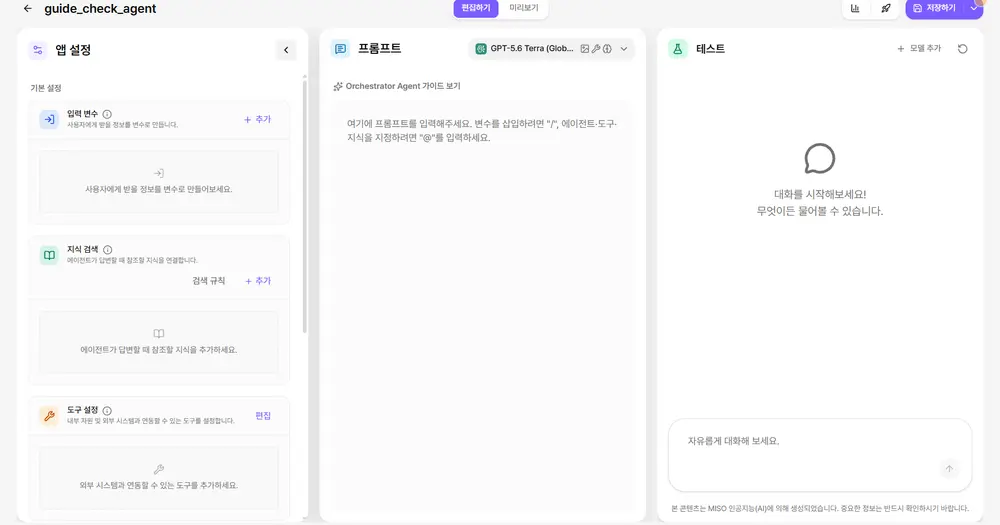<figcaption></figcaption></figure>

먼저 에이전트가 답변에 근거로 사용할 데이터부터 설정하겠습니다. 화면 왼쪽 "앱 설정" 영역의 "지식 검색" 카드에서 "+ 추가" 버튼을 클릭합니다. 앱 설정 영역이 접혀 있다면 먼저 펼쳐 주세요.

<figure><figcaption></figcaption></figure>

지식 선택 창이 열리고 사용할 수 있는 지식들이 보이게 됩니다. 지식이 많다면 검색창에 이름을 입력해 찾을 수 있습니다. company\_welfare를 클릭하여 선택한 뒤 "확인" 버튼을 클릭하여 설정합니다.

<figure>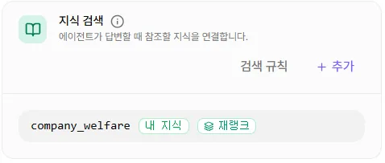<figcaption></figcaption></figure>

이제 지식 검색 카드에 방금 설정한 company\_welfare가 연결되어 있음을 확인할 수 있습니다.

<figure>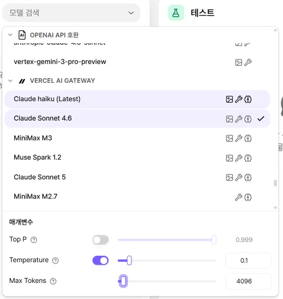<figcaption></figcaption></figure>

이번엔 GenAI 모델을 선택하겠습니다. 가운데 프롬프트 영역의 오른쪽 위에 있는 GenAI 모델 드롭다운을 클릭하여 현재 환경에서 사용 가능한 GenAI 모델 중 가장 적절한 모델을 선택합니다. 이 예제에서는 Claude Sonnet 4.6 모델을 사용하겠습니다.

모델 선택이 완료되었으면 아래쪽 매개변수 영역에서 Temperature 토글을 켜고 값을 0.1로 설정합니다. 모델에 따라 Temperature 항목이 없을 수도 있습니다. Temperature는 창의성이라고 비유하여 이해해 볼 수 있습니다. Temperature 값이 1에 가까울수록 GenAI 모델은 창의적인 답변을 하고 0에 가까울수록 경직된 답변을 합니다. 우리가 이번 예제에서 구현할 에이전트는 정확한 정보를 전달하는 것이 목적이므로 Temperature를 0.1으로 낮춰 보수적인 답변을 하도록 설정하겠습니다.

<figure>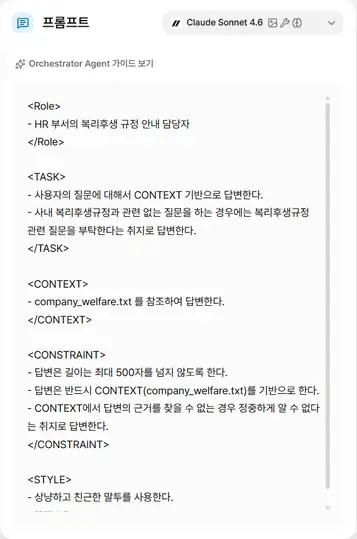<figcaption></figcaption></figure>

<details>

<summary>프롬프트</summary>

```
<Role>
- HR 부서의 복리후생 규정 안내 담당자
</Role>

<TASK>
- 사용자의 질문에 대해서 CONTEXT 기반으로 답변한다.
- 사내 복리후생규정과 관련 없는 질문을 하는 경우에는 복리후생규정 관련 질문을 부탁한다는 취지로 답변한다.
</TASK>

<CONTEXT>
- company_welfare.txt 를 참조하여 답변한다.
</CONTEXT>

<CONSTRAINT>
- 답변은 길이는 최대 500자를 넘지 않도록 한다.
- 답변은 반드시 CONTEXT(company_welfare.txt)를 기반으로 한다.
- CONTEXT에서 답변의 근거를 찾을 수 없는 경우 정중하게 알 수 없다는 취지로 답변한다.
</CONSTRAINT>

<STYLE>
- 상냥하고 친근한 말투를 사용한다.
</STYLE>
```

</details>

위와 같이 가운데 프롬프트 영역에 프롬프트를 작성합니다.

<figure>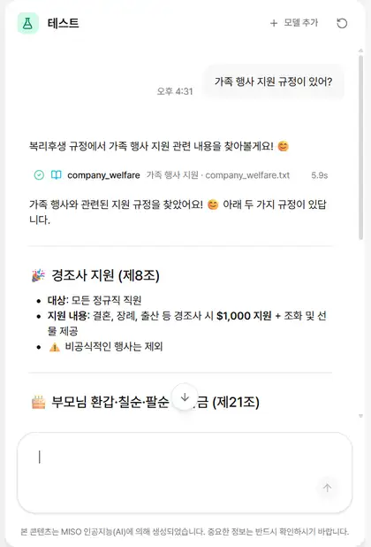<figcaption></figcaption></figure>

이제 모든 준비가 완료되었습니다. 화면 오른쪽의 "테스트" 영역에서 우리가 구현한 에이전트가 복리후생규정을 잘 안내해 주는지 테스트해 봅시다. 앞서 검색 테스트에서 활용했던 "가족 행사 지원"이라는 키워드로 질문해 보니 위와 같이 답변을 잘 해줍니다. 답변 위쪽에는 에이전트가 어떤 지식에서 어떤 검색어로 찾았는지도 함께 표시됩니다.

그런데 GenAI가 답변해 준 내용이 우리가 업로드한 데이터에 근거한 것이라고 어떻게 판단할 수 있을까요? 답변 아래에는 복사하기 버튼과 시계 모양의 로그 버튼 등이 있습니다. 로그 버튼을 클릭하면 아래와 같이 GenAI가 어떤 과정을 거쳐서 답변을 만들었는지 확인해 볼 수 있는 실행 로그가 출력됩니다. 상세 로그에서 company\_welfare 항목을 펼치면 검색에 사용한 입력값과 가져온 결과를 볼 수 있습니다.

<figure>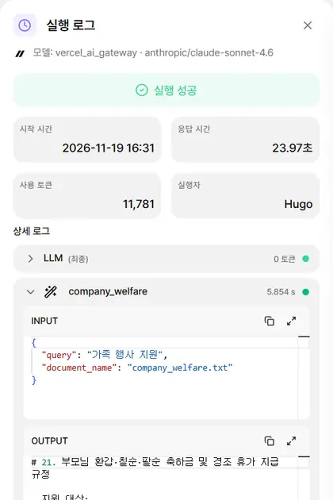<figcaption></figcaption></figure>

로그를 확인해 보니 GenAI는 "가족 행사 지원 규정이 있어?" 라는 질문에서 스스로 판단하여 "가족 행사 지원"이라는 검색 키워드로 company\_welfare.txt에서 검색했음을 알 수 있습니다. 또 이렇게 검색해서 가져온 데이터 중에서 경조사 지원 규정과 부모님 환갑·칠순·팔순 축하금 규정을 확인하였고, GenAI는 이 규정들이 사용자가 질문한 의도라고 스스로 판단하여 답변을 해준 것이란 것도 알 수 있습니다.

## 저장 및 배포

***

마지막으로 지금까지 구현한 복리후생제도 안내 에이전트를 배포하여 우리 회사의 다른 임직원들도 사용할 수 있도록 해보겠습니다.

<figure>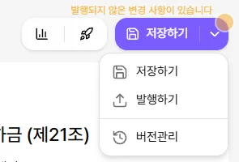<figcaption></figcaption></figure>

편집 화면 오른쪽 위의 "저장하기" 버튼 옆 화살표를 클릭하면 "저장하기", "발행하기", "버전관리" 메뉴가 나타납니다. 지금까지의 작업을 "저장하기"로 저장한 뒤 "발행하기"를 클릭합니다.

<figure>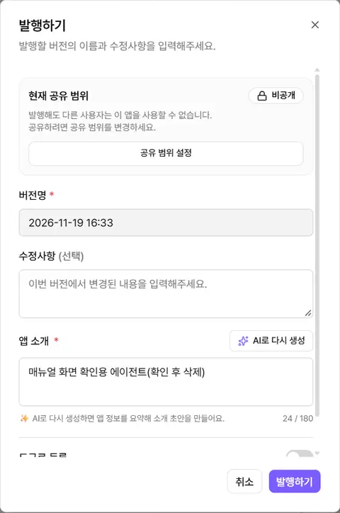<figcaption></figcaption></figure>

발행하기 창에서 버전명과 수정사항, 앱 소개를 확인한 뒤 "발행하기" 버튼을 클릭합니다. 현재 공유 범위가 "비공개"이면 발행해도 다른 사용자는 이 앱을 사용할 수 없습니다. 다른 임직원들도 사용하게 하려면 "공유 범위 설정" 버튼을 클릭해 공유 범위를 바꿉니다.

<figure>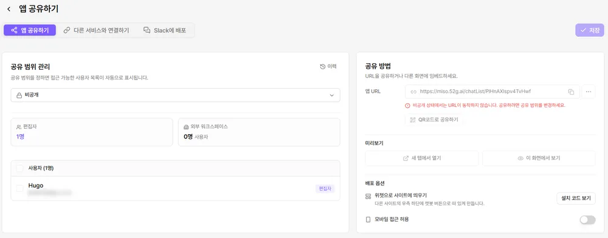<figcaption></figcaption></figure>

편집 화면 오른쪽 위의 로켓 모양 "앱 공유하기" 버튼을 클릭하면 위와 같은 앱 공유하기 화면이 열립니다. 이 화면에서 공유 범위를 관리하고, 앱 URL을 복사하거나 QR코드로 공유할 수 있습니다.

<figure>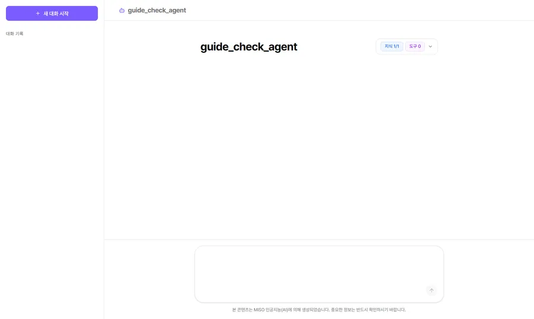<figcaption></figcaption></figure>

발행된 앱은 플레이그라운드 앱 목록에서 "사용하기" 버튼을 클릭하거나 앱 URL로 접속해 사용할 수 있습니다. 위와 같은 화면에서 임직원들이 바로 복리후생규정에 대해 질문할 수 있습니다.
